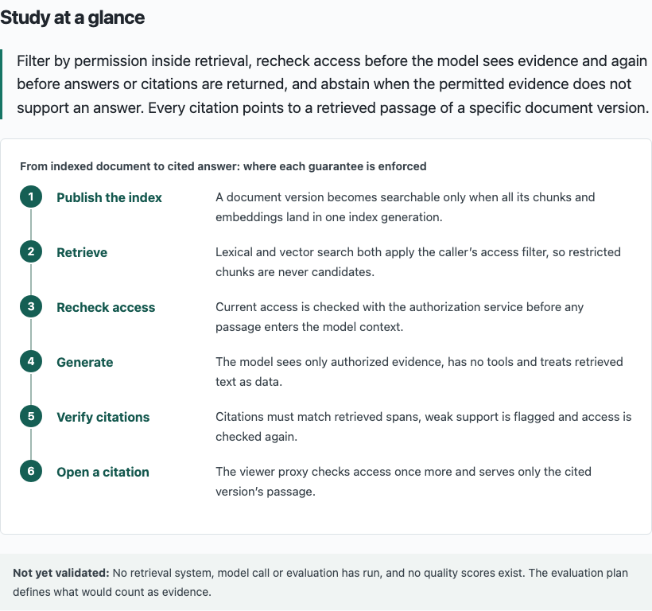
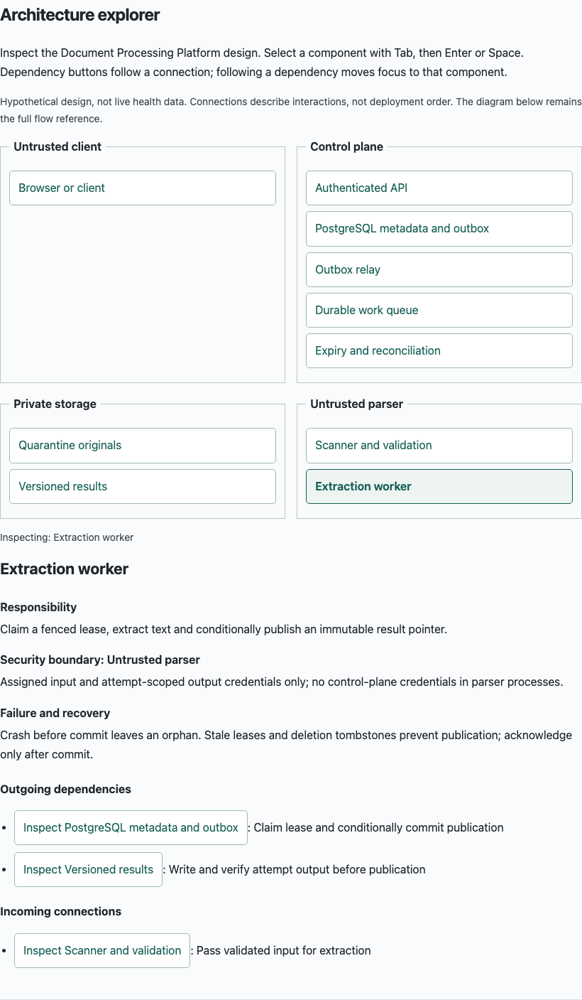

# System Design Lab

Six original architecture case studies that show the reasoning from business requirements to design decisions, failure handling and operating cost. Each one is a hypothetical design exercise with labelled assumptions and proposed targets; none describes a deployed system or claims measured production results.

**[Read the studies on the live site](https://kchan1028.github.io/system-design-lab/)** · [Key decisions](#key-decisions-and-alternatives) · [Tradeoffs](#tradeoffs-by-quality-attribute) · [What is measured](#assumptions-targets-and-evidence)



*Every study opens like this: the design's answer first, the critical path with the control at each step, then what has not been validated. Screenshot of the live RAG Document Search study.*

## Case studies

| Study | Problem it solves | Central decision |
|---|---|---|
| [Open Source Voice Platform](https://kchan1028.github.io/system-design-lab/studies/global-voice-platform/) ([source](src/global-voice-platform.md)) | Carry 50 million connected minutes a month across three continents with prepaid billing and reseller accounts | Independent voice regions with local media relays, capacity-tested Asterisk pools, one Python routing policy and a single authoritative owner for each prepaid balance |
| [Document Processing Platform](https://kchan1028.github.io/system-design-lab/studies/document-processing/) ([source](src/document-processing.md)) | Accept batches of invoices and forms and publish one authoritative extraction result per generation despite retries and crashes | Transactional outbox, sandboxed parsers and fenced conditional publication |
| [Event-Driven Order Processing](https://kchan1028.github.io/system-design-lab/studies/event-driven-orders/) ([source](src/event-driven-orders.md)) | Take an order once without charging twice or shipping an unpaid order | Orchestrated saga with outbox and inbox, and payment timeouts held as unknown until resolved |
| [Multi-Tenant SaaS Platform](https://kchan1028.github.io/system-design-lab/studies/multi-tenant-saas/) ([source](src/multi-tenant-saas.md)) | Keep one organization's data away from another in shared infrastructure | Pooled rows with layered isolation and a current membership check on every operation |
| [High-Traffic API Platform](https://kchan1028.github.io/system-design-lab/studies/high-traffic-api/) ([source](src/high-traffic-api.md)) | Keep a public catalog readable during traffic bursts without exhausting the origin | Shared cache with a hard 90-second age limit, and admission control separate from caller quotas |
| [RAG Document Search](https://kchan1028.github.io/system-design-lab/studies/rag-document-search/) ([source](src/rag-document-search.md)) | Answer questions from a permission-controlled collection with inspectable sources | Authorization inside retrieval with rechecks, versioned index generations and abstention when evidence is insufficient |

Each study covers requirements and scope, a Mermaid architecture diagram with trust boundaries, contracts, data rules, failure scenarios, operations, capacity arithmetic and a validation plan. Five include numbered architecture decision records.

## Interactive tools

Both tools are implemented for the Document Processing Platform only. The other studies are readable designs without interactive data sets.

- [Architecture explorer](https://kchan1028.github.io/system-design-lab/#/studies/document-processing?section=architecture-explorer): inspect each component's trust boundary, responsibility, failure recovery and dependencies by keyboard or pointer. Following a dependency moves focus to that component.
- [Tradeoff analyzer](https://kchan1028.github.io/system-design-lab/#/studies/document-processing?section=architecture-tradeoff-analyzer): compare synchronous requests, queue workers and durable workflows against assumptions you edit and apply. It gives no score, winner or price.
- Failure model: `npm run simulate` runs a deterministic model of duplicate delivery, worker crashes, stale leases and deletion races ([assumptions and limits](docs/simulation.md)).



## Key decisions and alternatives

A selection from the 21 decision records in the studies. Each record states the alternative considered and the cost accepted.

| Decision | Alternative considered | Cost accepted |
|---|---|---|
| [ADR 001](src/document-processing.md#adr-001-asynchronous-jobs-with-a-transactional-outbox): persist job intent and an outbox event in one transaction, then dispatch asynchronously | Synchronous parsing, or a direct database-plus-queue dual write | Relay and reconciliation work, extra latency and duplicate delivery |
| [ADR 005](src/document-processing.md#adr-005-versioned-extraction-rather-than-in-place-replacement): reprocessing creates a new versioned generation | Overwriting results in place | Temporary duplicate storage and explicit version semantics |
| [ADR 007](src/event-driven-orders.md#adr-007-orchestrated-saga-for-order-outcomes): a persisted coordinator owns the saga and compensation | Pure choreography, or a durable workflow engine | Central coordination code; engine semantics deferred until a prototype |
| [ADR 008](src/event-driven-orders.md#adr-008-preserve-stock-during-uncertain-payment): hold reserved stock until an uncertain payment resolves | Automatic inventory expiry | Possible stock starvation during provider incidents, needing aged-hold alerts |
| [ADR 010](src/multi-tenant-saas.md#adr-010-pooled-rows-with-layered-isolation): pooled tenant rows with layered isolation | Database per tenant | A wider administrative and runtime blast radius |
| [ADR 011](src/multi-tenant-saas.md#adr-011-primary-membership-checks-before-cached-content): resolve current membership on every operation | Trusting token roles or cached membership | Primary-database dependency and lookup load |
| [ADR 015](src/high-traffic-api.md#adr-015-bounded-stale-service-with-authoritative-revalidation): a finite fresh-plus-stale cache window, then fail | Always-fresh reads, or indefinite stale service | More origin dependency than serving stale indefinitely; the window needs business agreement |
| [ADR 016](src/high-traffic-api.md#adr-016-quota-fairness-separate-from-origin-protection): caller quotas separate from origin concurrency and queue limits | One requests-per-second limit | Approximate quotas during counter outages; expensive actions fail closed |
| [ADR 018](src/rag-document-search.md#adr-018-authorization-filtering-inside-retrieval-with-rechecks): filter by permission inside retrieval, then recheck | Post-filtering results, or separate indexes per group | Depends on efficient filtered search at the expected label count, which is untested |
| [ADR 021](src/rag-document-search.md#adr-021-abstain-and-show-sources-rather-than-answer-without-support): abstain and show sources when evidence is insufficient | Always answering, or search results only | A lower answer rate; false abstention must be measured |

## Tradeoffs by quality attribute

| Attribute | Where the studies make the tradeoff |
|---|---|
| Scalability | High-Traffic API: at a 98% assumed edge hit ratio about 200 of 10,000 peak requests/second reach the origin; at 80% it is 2,000, so admission control, not the hit ratio, protects the database. Voice: eight Asterisk servers per region at a 500-call benchmark target leave 8,000 calls after losing a region, against a 6,000-call peak. |
| Security | Multi-Tenant SaaS checks current membership on every operation instead of trusting cached roles, at the cost of database load. RAG search filters by permission inside retrieval and rechecks before generation and citation. Document processing runs parsers sandboxed without network access or control-plane credentials. |
| Reliability | Orders keep a payment timeout as unknown rather than declined, so a lost response does not become a second charge. Document processing publishes only with a current lease token, so a stale worker cannot overwrite a result. The API returns unavailable after its 90-second age limit instead of serving old data. |
| Maintainability | Orders start as explicit logical boundaries that can run as a modular monolith before splitting services. Multi-Tenant SaaS keeps four fixed roles instead of a custom policy language. The voice platform keeps one routing policy owner so two ranking systems never compete. |
| Operational cost | Document processing shows OCR sensitivity with an invented illustrative rate ($15,000 versus $3,000 a month), labelled as not a quote. RAG search estimates one full embedding pass at about three billion tokens. The site itself accepts about 1.4 MB more JavaScript per diagram page to keep readable diagrams ([measurement](docs/performance.md)). |

## Assumptions, targets and evidence

| Type | What it means here | Examples |
|---|---|---|
| Assumptions | Planning inputs chosen for the exercise | 50 million voice minutes a month; 50,000 documents a day; 20,000 orders a day; 500 tenants; 50 million API reads a day; 200,000 searchable documents |
| Proposed targets | Goals a real implementation would have to prove | 99.9% monthly availability for the document, order and tenant APIs; 99.95% and p95 under 200 ms for public catalog reads; a 90-second maximum cache age; p95 retrieval under 800 ms for RAG search |
| Measured evidence | Things actually run and checked in this repository | Unit and Chromium browser tests on every pull request, including automated axe accessibility checks; a deterministic failure-model simulation; a dated local bundle-size measurement |

No study has a backend, deployment, load test or evaluation. Capacity figures are arithmetic, not benchmarks, and the frontend tests validate only this site's rendering, navigation and accessibility.

## Browse the documentation

The site is published with GitHub Pages at [kchan1028.github.io/system-design-lab](https://kchan1028.github.io/system-design-lab/). Each merge to main is deployed by the Publish documentation workflow after the same checks as CI. Use the on-page contents to jump to a topic; section URLs can be shared and reloaded.

## Run locally

Use Node.js 24 and npm. No environment variables, account, or credentials are needed.

```sh
npm ci
npm run dev
```

Open the address printed by Vite. To validate:

```sh
npm test
npm run lint
npm run build
npx playwright install chromium
npm run test:e2e
```

`npm run build` also prerenders a static, crawlable page for each study at `studies/<id>/` and writes `sitemap.xml`; those pages hand over to the interactive hash route when JavaScript loads. Run the build before `npm run test:e2e`, which checks the built pages. `npm run preview` serves the built `dist/` directory. Relative asset paths and hash routes support static subdirectory hosting without route rewrites. GitHub Pages publishes the verified static build after a merge to main. The deployment job alone has Pages/OIDC write access; PR checks remain read-only.

## Design and evidence

Case studies are independent exercises, not descriptions of deployed systems. Proposed targets and workload assumptions must be labelled. Capacity arithmetic is not measured performance. Only reproducible measurements may be called benchmarks.

The site uses React, Vite, TypeScript, plain CSS, react-markdown, and Mermaid. Markdown is repository-owned; raw HTML is not enabled. Mermaid runs in strict mode. Never render external diagram input without a separate security review. Mermaid is loaded only when a diagram renders and keeps its default ELK layout for readability; the resulting large-chunk build warning is an accepted, [measured tradeoff](docs/performance.md).

## Tradeoff analyzer details

The Document Processing Platform analyzer compares synchronous requests, queue/outbox workers and durable workflows. Edit duration, arrival pattern, recovery and operating-capacity assumptions, then apply them to update qualitative reasoning. Unknown values remain unresolved. Evidence notes do not alter the rules. State is local to the mounted page and resets on reload; there is no storage, telemetry or external service. Comparisons are authored hypotheses, not rankings, benchmarks or vendor quotes.

## Failure-handling evidence

Run `npm run simulate` to inspect deterministic duplicate-delivery, worker-crash, stale-lease, and deletion scenarios. [Model assumptions and limits](docs/simulation.md) explain what this demonstrates and what still needs real infrastructure tests. No throughput or production-correctness claim is made.

## Repository guide

- `src/content.ts`: original documentation and study index
- `src/App.tsx`: navigation and document layout
- `src/Diagram.tsx`: lazy diagram rendering, cleanup, and fallback
- `e2e/`: Chromium navigation, responsive layout (320 to 1440px), focus, history and automated axe checks. Manual screen-reader testing has not been performed.
- [Contributing](CONTRIBUTING.md), [Security](SECURITY.md), [Roadmap](docs/roadmap.md)

## License

No project license has been selected. Public availability does not grant a general license to reuse this project. Dependency licenses remain their own.
