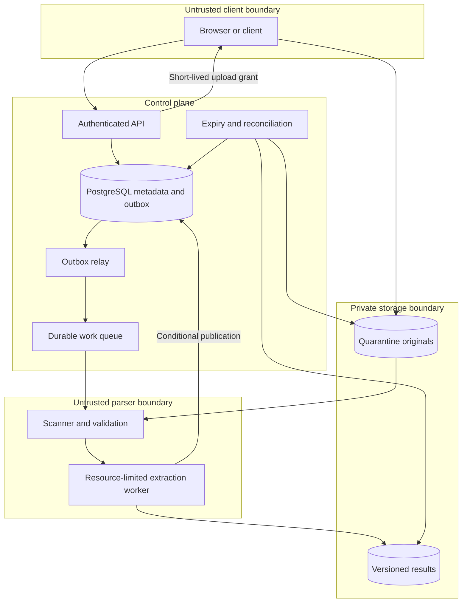

# Document Processing Platform

An original, hypothetical design for tenant-scoped PDF and image ingestion. This is a design exercise, not an implemented service or a description of an employer's system. All numbers below are assumptions or proposed targets; none are measured benchmarks.

## Problem and scope

Small operations teams need to upload batches of invoices and forms, extract searchable text, inspect processing failures, and retrieve a versioned JSON result. A user must know whether a document was accepted, rejected, still processing, or ready. The platform must recover from duplicate requests and worker crashes without publishing competing results.

The first release accepts PDF, PNG, and JPEG, limits each document to 20 MiB and 100 pages, and produces text with page offsets and extraction provenance. It does not make financial decisions, validate invoice truth, run arbitrary plugins, perform RAG, or promise perfect OCR. Password-protected and unsupported files are rejected. Human verification remains necessary before acting on extracted values.

## Requirements and proposed targets

- Tenant members can submit, inspect, download results, and request deletion only within an authorized tenant. Server-side identity membership determines tenant scope.
- Submission acknowledges a durable job record before returning success. Upload completion is a separate operation from registration.
- At-least-once delivery is expected. A logical processing generation has one authoritative published result.
- Proposed availability target: 99.9% monthly for the control API. Proposed latency target: p95 registration under 500 ms, excluding file transfer. Proposed completion target: 95% of accepted documents within five minutes at the assumed peak workload, excluding explicitly reported provider outages. These need load tests before any commitment.
- Originals and results expire after 30 days by default. Deletion immediately blocks reads and new work, then removes live copies within 24 hours. Backup expiry can take 35 more days; disclose that distinction to customers. No regulatory compliance certification is claimed.
- Single region, multiple availability zones initially. Proposed RPO 15 minutes and RTO four hours for regional recovery require restore drills. Cross-region failover is outside the first release.

## Workload and capacity assumptions

Assume 100 tenants, 50,000 documents/day, mean 2 MiB/document and 10 pages/document. Peak arrival is 10 times the daily average for 15 minutes. File size, page count, and OCR time distributions matter more than the means.

50,000 / 86,400 = 0.58 documents/second on average; assumed peak is 5.8/second. At an assumed mean 12 worker-seconds/document, 70 concurrent slots are busy at peak. At 70% planned utilization, provision 100 slots (70 / 0.70), with per-tenant concurrency caps and queue-based scaling. This is sizing arithmetic, not a throughput result. If mean service time doubles to 24 seconds, 100 slots sustain only 4.17 documents/second, so a 15-minute peak adds about 1,470 queued jobs. Measure p95/p99 and correlated slow files before promising the five-minute target.

Originals add 97.7 GiB/day (50,000 × 2 MiB). Thirty-day live original storage is about 2,930 GiB before replication, versioning, incomplete uploads, and backup overhead. Assume results average 0.2 MiB: another 293 GiB at steady state. One metadata row set at an assumed 4 KiB/document adds about 5.7 GiB over 30 days before indexes, attempts, audit events, and database maintenance. The largest allowed file is not the average file; quota checks must use actual bytes.

## Architecture and trust boundaries



The API never parses a document in its request process. A transaction creates a job and an outbox event together; a relay publishes events and marks them sent only after queue acknowledgement. Duplicate publications are safe. PostgreSQL is the source of job truth; the queue is a delivery mechanism, not the state machine.

Clients upload to a server-chosen immutable object key through a short-lived, size-limited grant. Completion verifies the exact object version, size, checksum and tenant ownership. Bucket event notifications may prompt reconciliation but cannot alone authorize processing. Incomplete registrations expire after one hour. Object replacement after verification is prevented by processing an immutable version; workers verify the stored digest again.

A scanner validates format signatures, page count and malware policy before extraction. A clean scan is not proof that a parser is safe. Run parsers without outbound network access, with read-only runtime images, per-job temporary storage, CPU/memory/time limits, decompression limits and no control-plane credentials. Sandboxed workers can read only their assigned input and write an attempt-scoped output prefix. Untrusted text is data, never shell arguments or executable templates.

## API contracts

All routes require authenticated tenant membership. Derive identity from validated issuer/audience/expiry claims; do not trust a tenant header without membership verification. Use opaque IDs and return a tenant-scoped 404 for inaccessible resources. Error bodies contain stable codes and a request ID, not parser stack traces.

- `POST /v1/documents` requires `Idempotency-Key` and `{ filename, content_type, size_bytes, sha256 }`. Return 201 with document ID, upload grant, required headers, expiry and `awaiting_upload` state. Reject unknown formats (415), excess size (413), exceeded quotas (429 plus Retry-After), and mismatched key reuse (409).
- `POST /v1/documents/{id}/complete` includes immutable object version and checksum. Return 202 only after verification and the job/outbox transaction commits. Repeated completion returns the existing generation and status; it never creates another job implicitly.
- `GET /v1/documents/{id}` returns lifecycle state, processing generation, timestamps and safe failure code. Support conditional requests with an ETag and advise exponential polling capped at 30 seconds.
- `GET /v1/documents/{id}/result` returns versioned JSON or a short-lived authorized download grant only when ready; otherwise 409 `result_not_ready`, or 410 for an expired/deleted authorized record. Never expose bucket keys as authorization.
- `POST /v1/documents/{id}/reprocess` requires an idempotency key and expected current generation. Create a new generation atomically, preserving the previous result until the new result is ready. Reject a stale expected generation with 409.
- `DELETE /v1/documents/{id}` returns 202 once a durable tombstone and deletion event exist. Repeating deletion is safe. No subsequent result download grants are issued; existing grants may remain valid until their short expiry, which is part of the stated deletion semantics.

Example synthetic result:

```json
{"document_id":"doc_example","generation":1,"schema_version":1,"extractor_version":"example-v1","pages":[{"page":1,"text":"Synthetic invoice","warnings":[]}],"warnings":["Human verification required"]}
```

## Data model and invariants

PostgreSQL tables use tenant-aware constraints; every query includes tenant scope. Row-level security can provide defense in depth when connection-pool tenant settings are transaction-local and tested. It does not replace API authorization.

- `documents`: `(tenant_id, id)` primary key; immutable source object version/digest, lifecycle, current generation, expiry, deleted_at, optimistic version.
- `processing_jobs`: `(tenant_id, document_id, generation)` unique; extractor/config version, state, attempt count, lease token, lease expiry, result pointer and failure code. Composite foreign key to documents prevents cross-tenant references.
- `attempts`: job key plus attempt ID; timings, safe error class, resource use, attempt-scoped object prefix. No raw text in error records.
- `idempotency_requests`: `(tenant_id, operation, key)` unique; canonical request hash, resource/generation, response status and expiry. Registration retention is 24 hours, documented to clients. Expired keys may create a new document; this is not content deduplication.
- `outbox_events`: event ID, aggregate key, generation, type, payload schema version, created_at, published_at, next_attempt. Store identifiers only, never file bytes.
- `audit_events`: actor, tenant, action, resource, timestamp, outcome and request ID. Restricted append-only access, with retention separate from document payloads.

Separate document lifecycle (`active`, `deleting`, `deleted`, `expired`) from job state (`awaiting_upload`, `queued`, `running`, `ready`, `rejected`, `failed`). A ready job does not override a deleting document. Publishing a result requires an active document, matching generation, and current lease token in one transaction.

## Idempotency and publication protocol

1. Atomically reserve an idempotency key with its canonical payload hash and the new document row. Concurrent identical requests resolve to the same resource; conflicting payloads return 409. A lost HTTP response is retried using the same key.
2. Complete upload in a transaction that changes the job from awaiting_upload to queued and inserts an outbox event. A database rollback creates neither change. An object uploaded without completion is reclaimed after the registration expires.
3. Worker claims a job with a conditional update and a fresh fencing token. Extend a bounded lease while processing. Queue visibility expiry may cause another delivery; the database lease, not delivery count, controls ownership.
4. Write an immutable attempt-scoped result and verify its checksum. Commit its pointer using a conditional update matching job generation, lease token and active lifecycle. A stale worker cannot publish after a replacement worker or deletion has won.
5. Acknowledge queue delivery after the publication transaction. A crash after commit but before acknowledgement yields a duplicate delivery that sees ready and exits. A crash after object write but before commit leaves an orphan for a delayed sweeper, never a ready pointer to an unwritten object.

There is no cross-service exactly-once claim. The guarantee is one authoritative result pointer per logical generation, conditional on database transaction semantics. Duplicate computation and orphan objects remain possible and are budgeted. Do not deduplicate by document digest across tenants; that leaks existence and complicates deletion rights.

## Failure handling and recovery

Transient object-store, queue or database failures use exponential backoff with jitter and a maximum elapsed retry budget of 30 minutes. Parser crashes get at most three attempts; invalid format, malware detection, password protection and limit violations are terminal rejections. Do not retry an unchanged malformed file indefinitely.

A reconciliation worker finds queued jobs without recent dispatch, expired running leases, unsent outbox events, stuck deletions and old attempt objects. It republishes by stable job ID. Dead-letter entries retain identifiers and safe reasons. Operator redrive checks current lifecycle/generation and records an audit event; it cannot resurrect deleted documents.

- API outage: existing queued work can continue; clients retry registration with the same key. Readiness fails when durable registration cannot be guaranteed.
- Queue outage: transactions still record outbox entries, subject to a backlog admission limit. Reject new work before metadata/storage exhaustion; do not promise a completion window while dispatch is unavailable.
- Poison document or decompression bomb: terminate within enforced resource limits, quarantine by policy, reject with a safe code and alert on a correlated spike.
- Database unavailable after extraction: keep attempt output, retry conditional publication within the lease budget; never report ready without the committed pointer.
- Tenant burst: use tenant quotas, per-tenant concurrency and fair scheduling so a large tenant cannot consume every slot. Separate scanner and OCR pools to prevent long jobs blocking validation.
- Deletion races: tombstone first; revoke API reads, cancel queued work, prevent publication, then delete all input/result versions and temporary artifacts. Retry deletion until confirmed. Lifecycle storage rules are a backstop, not proof of completion.
- Regional loss: restore metadata and keys, reconcile object versions and pending jobs, and suppress reads to missing results. Test backup restoration and deletion-tombstone replay before reopening traffic.

## Observability and operating decisions

Propagate request ID, document ID, generation and attempt ID across API, outbox and worker spans. Do not log file names, extracted text, upload grants, tokens, or raw document content. Keep tenant IDs out of unbounded metric labels; use restricted structured logs for tenant investigations.

Measure registration success/latency, accepted-to-ready age, oldest queued job, outbox lag, retry/rejection rates, lease expirations, orphan bytes, deletion age, parser resource use and cost per page. Completion metrics count documents once per generation and distinguish accepted work from rejected uploads. Publish dashboards with denominators and exclusion rules.

Proposed paging: sustained control-API error-budget burn, oldest accepted job beyond five minutes with a growing backlog, or deletion age approaching 24 hours. Provider-wide errors open a circuit breaker and pause dispatch; parser failures by extractor version can trigger rollback. Use runbooks for backlog, stuck deletion, malformed files and restore. Synthetic canaries contain no customer data. Alerts need tuning in a pilot; thresholds are not validated here.

## Cost model and sensitivity

Use symbolic unit rates to avoid pretending to quote current vendor prices. Monthly cost = stored GiB × storage rate + worker-seconds × compute rate + OCR pages × page rate + requests × request rate + database + observability + backup + egress. Obtain regional/vendor quotes before choosing a provider.

For a 30-day planning month, 1.5 million documents × 12 seconds = 18 million worker-seconds (5,000 slot-hours), excluding scanning, retries and idle capacity. At 10 pages/document, all-OCR processing is 15 million pages/month; if only 20% require OCR, that is 3 million pages. Assuming an illustrative invented rate of $0.001/page solely for sensitivity, those two scenarios are $15,000 and $3,000. This is neither a vendor quote nor an observed bill. Retry amplification of 1.2 raises page charges by 20% if the provider charges every attempt.

Storage starts near 3,223 GiB for originals plus results under the retention assumptions; versioning, replicas and backups increase it. Compute pricing must specify CPU/RAM per slot: a slot-hour is not a cloud billing unit by itself. Minimum idle workers, managed database redundancy, logging volume, scanning and network transfer can dominate a small pilot. Set per-tenant page/byte quotas and a monthly spending alert; measure cost by workload class before optimizing.

## Architecture decision records

### ADR 001: asynchronous jobs with a transactional outbox

Proposed: persist job intent and outbox event in one PostgreSQL transaction, then dispatch asynchronously. Synchronous parsing makes request timeouts and client retries hard to distinguish from failures. A direct database-plus-queue dual write can lose work between writes. Cost: relay and reconciliation operations, additional latency, and duplicate delivery. Revisit when a workflow engine reduces operational burden enough to justify its persistence model and migration cost.

### ADR 002: private object storage and metadata references

Proposed: keep bytes outside PostgreSQL and reference immutable versions. Database blobs simplify one transactional boundary but inflate backups and replication. Object storage supports independent lifecycle policies but introduces orphan cleanup and publication ordering. Revisit for very small payloads or strict single-store requirements.

### ADR 003: pooled tenant metadata with explicit isolation

Proposed: tenant-aware composite keys, authorization checks, transaction-local row-level security context, private object prefixes and scoped worker credentials. A database per tenant improves isolation but adds provisioning, connection and migration overhead. Pooled storage accepts a larger shared failure domain. Revisit for contractual isolation, key separation, residency or large noisy tenants; those requirements are not silently assumed satisfied.

### ADR 004: polling before webhooks

Proposed: bounded polling and conditional reads for the first release. Webhooks improve integrations but require signing, replay protection, destination validation, SSRF controls and retry delivery state. Revisit after actual integration demand. No arbitrary callback URLs are accepted in this design.

### ADR 005: versioned extraction rather than in-place replacement

Proposed: reprocessing creates a new generation with recorded extractor and schema versions. Keep the previous ready generation visible until successful replacement, unless deleted/expired. Cost: temporary duplicate storage and explicit version semantics. Overwriting results is simpler but prevents reproducible debugging and makes retry races ambiguous.

## Executable failure model

This repository includes a deterministic single-job model of duplicate delivery, a crash before publication, stale lease publication, and deletion races. Run `npm run simulate` locally and read `docs/simulation.md` for its assumptions and limits. It exercises conditional publication semantics; it is not a real worker, database, queue, or benchmark.

## Validation plan and unresolved questions

Before implementation commitments, benchmark synthetic and permission-cleared documents across byte/page/format/OCR distributions. Report hardware, software versions, concurrency, latency percentiles, rejection rates and sample sizes. Test duplicate completion, conflicting idempotency keys, tenant access attempts, stale lease publication, worker termination at each publication step, deletion races, parser resource exhaustion, queue outage and restored backups.

Open questions: actual OCR proportion and accuracy needs; maximum burst duration; required residency; allowed parser packages and their licenses; retention policy exceptions; customer-managed encryption; team on-call capacity; provider billing behavior during retries. Resolve these with prospective users and a pilot. No benchmark, compliance status or production reliability result is claimed by this study.
