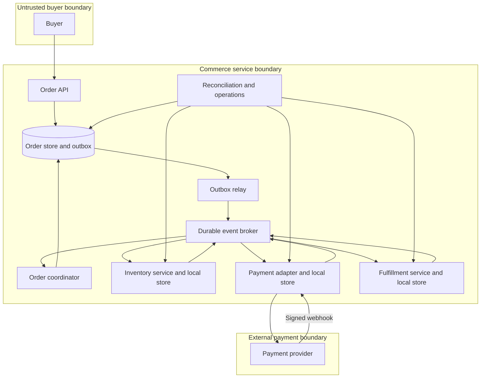

# Event-Driven Order Processing

An original, hypothetical design for a small retailer selling physical goods. All workloads and service targets are planning assumptions, not measurements. This study implements no commerce backend and contains no employer or customer material.

## Business problem and scope

A buyer must be able to submit an order once, learn whether it was accepted, and receive a clear outcome when stock or payment is unavailable. Operations staff need to find orders stuck between systems without charging twice or shipping an unpaid order.

The first release covers one currency, one warehouse and a payment provider supporting idempotency keys and status lookup. Payment card data goes directly to the provider; this design stores opaque references only and claims no compliance certification. Tax calculation, returns, partial shipments, subscriptions and multi-region writes are outside scope. Capturing a payment is not proof of settlement or fulfillment.

## Requirements and assumptions

- Orders are accepted only after durable local persistence. Acceptance means processing started, not that payment or shipment succeeded.
- Inventory reservations cannot exceed available stock under the inventory service's transaction semantics. A failed order releases its reservation or raises a reconciliation task.
- One logical payment operation uses one stable provider idempotency key. Uncertain payment outcomes stay pending until resolved; a timeout is never treated as a definitive decline.
- Shipment authorization requires both confirmed capture and a valid inventory commitment. Cancellation is rejected once shipment authorization is committed; later requests follow a separate returns/refund process.
- Assume 20,000 orders/day, a peak of 20 submissions/second for ten minutes, and up to 20 lines/order. Average submission rate is about 0.23/second; a ten-minute peak alone would contain 12,000 orders. Validate this distribution with a pilot.
- Proposed control-API target: 99.9% monthly availability and p95 durable acceptance below 500 ms, excluding provider calls. Proposed normal completion target: 95% of accepted orders reach confirmation or rejection within two minutes. Provider outages and unresolved payment outcomes must remain visible in separate age metrics. These are untested targets.
- Single-region deployment initially. Proposed RPO 15 minutes and RTO four hours require restore drills and provider reconciliation before fulfillment resumes. Losing recent local payment records is especially dangerous; never blindly recreate charges after restore.

## Architecture and trust boundaries

The broker is an at-least-once transport. Every state-owning service commits its local state change, consumer inbox record and outgoing outbox records in one local database transaction. The diagram's service-to-broker arrows abbreviate local outbox relays; no consumer directly dual-writes business state and a broker acknowledgement. There is no distributed database transaction across inventory, payment and orders.

An order coordinator persists a saga state and issues versioned commands. Inventory, payment and fulfillment own their respective facts. The coordinator cannot manufacture payment success from an event gap. Services authenticate each other with narrowly scoped identities. Broker ACLs restrict which service can publish each event family; payload schemas and expected producer identities are validated. The buyer cannot publish internal events.

## API and event contracts

`POST /v1/orders` requires authentication, an `Idempotency-Key`, cart version, delivery reference and an opaque provider payment-method reference. The server obtains product prices and stock identifiers from trusted catalogs; client-supplied totals are never authoritative. Validate that the payment-method reference is usable by this buyer and bind it to the accepted order amount; a client reference alone is not authorization to charge. Store a canonical request hash with the buyer-scoped key for seven days, an illustrative retention choice that must be documented. Identical retries return the same order and receipt; conflicting reuse returns 409. After key expiry a submission may create a new order, so clients must inspect their order history before resubmitting.

Return 202 with order ID, `processing` state and status URL only after the order and `OrderSubmitted` outbox record commit. `GET /v1/orders/{id}` checks buyer ownership or audited staff authorization and returns current state, version, safe reason and timestamps. Use 404 for inaccessible orders. `POST /v1/orders/{id}/cancel` includes an expected version and idempotency key; it initiates cancellation only before shipment authorization has been committed by the coordinator. Concurrent authorization and cancellation contend on the same order version. This cutoff is intentionally earlier than physical warehouse handoff: an authorization already in transit cannot be safely revoked by an independent database write. Return 409 when cancellation is too late or stale; do not imply a refund has completed.

Events carry `event_id`, `event_type`, `schema_version`, `order_id`, `aggregate_version`, `occurred_at`, correlation/causation IDs and a minimal payload. Commands additionally carry a stable `operation_id` and expected workflow generation. No addresses, card details or authentication tokens belong on the shared broker. Resolve delivery details through an authorized fulfillment lookup.

Partition order-related streams by order ID for useful local ordering, but do not assume a total order across different service streams. Deduplicate by stable event ID in each consumer inbox. Validate state transitions and expected operation IDs as well: two different event IDs describing the same capture must not create two business effects. Unknown schema versions and impossible transitions go to a quarantined incident queue; they do not silently advance the saga.

## Data ownership and invariants

- Order service: order lines with immutable accepted prices, buyer ID, state/version, saga step and outstanding operation IDs; request-key records; inbox, outbox and audit entries. One current transition wins through compare-and-set on the order version.
- Inventory service: SKU stock counters and reservation records keyed by stable reservation operation ID. Reserve all order lines atomically within this single inventory database, or reserve none. Conditional quantity updates and uniqueness constraints prevent overselling within this model. A release received before a delayed reserve creates a terminal cancellation marker for that reservation operation, so the late reserve cannot acquire stock. Commit and release use legal state transitions on the same reservation version; a stale command cannot resurrect released stock. Multi-warehouse allocation would require a different design.
- Payment adapter: payment operation ID, provider key/reference, amount/currency, state (`pending`, `unknown`, `captured`, `declined`, `refunding`, `refunded`) and last reconciliation time. Unique logical operation keys prohibit creating a replacement capture while an earlier attempt is unresolved.
- Fulfillment service: one shipment operation per order generation, authorization ID and warehouse handoff status. It deduplicates the coordinator’s committed authorization; cancellation after that authorization follows a separate business process. No independently revocable authorization is assumed.
- Every service owns its inbox/outbox, including retry schedules and audit records. Inbox retention must cover broker retention and allowed replay; deleting deduplication records before a replay can repeat effects. Keep business-level uniqueness constraints beyond inbox expiry.

The central safety rule is that `confirmed` requires captured payment and committed inventory for the expected operations, while shipment authorization is emitted only from that confirmed state. Shipment acceptance and order projection may be temporarily inconsistent; show that lag explicitly. A rejection with an unresolved payment is not a terminal customer outcome. Mark it `needs_attention` until capture/refund facts are known.

## Saga and compensation protocol

1. Persist `processing` order plus `ReserveInventory` outbox command. The relay publishes with a stable ID and retries until acknowledgement. A crash after publish but before marking sent produces a duplicate.
2. Inventory consumes in a transaction: insert inbox ID, reserve lines conditionally, and emit `InventoryReserved` or `InventoryRejected`. A duplicate returns the recorded outcome without reserving again.
3. On reservation success the coordinator requests capture using a stable payment operation ID and the accepted amount. Inventory reservations do not expire independently once capture begins. This avoids stock release during an uncertain charge, at the cost of held stock during outages. Reconciliation age limits and operator escalation are mandatory; a new expiry policy would require explicit coordinator arbitration.
4. The adapter durably records the capture intent before calling the provider. It reuses the same provider idempotency key for supported retries. A timeout becomes `unknown`: look up the original operation and consume verified webhooks. If the provider's idempotency window has expired, do not retry capture blindly; use provider lookup and manual escalation. A local transaction cannot atomically include an external charge.
5. Capture success causes the coordinator to commit inventory, then atomically mark the order confirmed, close cancellation and emit shipment authorization through its outbox. This final order transition checks that cancellation has not already won; if cancellation won, compensate the capture and release or reverse the inventory commitment instead. Inventory commit is idempotent. If commit is definitively impossible after capture, move to compensating, request a uniquely keyed refund, and release any remaining reservation. Report pending compensation until confirmed; a refund request is not a completed refund.
6. A definitive payment decline releases inventory. Cancellation before the authorization cutoff also enters compensation: resolve any pending capture, refund a confirmed capture if necessary, then release stock. Stable release/refund keys make retries safe. Never release solely because a payment timeout elapsed.
7. Fulfillment accepts one authorization per order generation and emits its durable handoff outcome through its outbox. The coordinator records that outcome. Missing acknowledgements trigger lookup of the original shipment operation rather than a new shipment.

There is no exactly-once end-to-end guarantee. Local atomic transitions and unique operation IDs prevent selected duplicate effects; external safety also depends on provider idempotency and lookup behavior. Duplicate computation, delayed events and manual exception handling remain possible.

## Failure modes and reconciliation

- Broker outage: local transactions retain outbox intent. Reject new orders when oldest intent or reserved-stock backlog exceeds an admission threshold established in testing. Do not acknowledge processing that has not been persisted.
- Relay crash after publication: inbox deduplication and business-operation uniqueness suppress duplicate reservations and shipments. Broker offsets alone are insufficient.
- Consumer crash before commit: redelivery repeats the transaction. Crash after commit before acknowledgement: inbox entry suppresses repetition and the local outbox still carries the outcome.
- Out-of-order or stale outcome: match operation ID and legal saga transition. Persist a pending fact or reconcile authoritative state; never overwrite a later version with an older event. A late capture during cancellation triggers compensation, not fulfillment.
- Provider timeout or contradictory webhook: keep `unknown`, authenticate the webhook signature and replay window, deduplicate its provider event ID, and query provider truth. Route unresolved contradictions to staff with restricted access.
- Inventory service unavailable after capture: hold the order pending commit and retry the original operation. Do not ship or initiate another capture. Escalate by age; compensate only after resolving whether stock was committed.
- Poison event: quarantine safe identifiers, schema version and reason; alert on queue age and count. Redrive with the original event/operation IDs after repair, recording an audit trail. Never bypass authorization or deduplication during replay.
- Regional restore: pause new fulfillment, restore inbox/outbox and saga state, then compare payment and shipment references with providers. Recovered events must not recreate effects whose local history was lost. Resume only after reconciliation establishes safe ownership of pending operations.

A scheduled reconciler compares aged nonterminal orders with reservation, payment and fulfillment operation status. Use durable cursors and bounded batches so one incident cannot starve all accounts. Re-emit missing intent only with the original operation ID. Compare captured amounts and currency to accepted totals, locate orphan reservations, and track refund obligations separately from order completion. Daily settlement comparison can find discrepancies not visible from webhooks. Staff resolve exceptions through versioned commands with reason codes; no direct database edits or silent state overrides.

## Security and privacy

Check buyer ownership on every order read and mutation; opaque IDs are not authorization. Staff privileges separate support inspection from refund approval, and high-value manual refunds require an additional approval policy chosen by the business. Keep audit trails of identity, operation, result and reason without full payment payloads.

Authenticate provider webhooks before accepting facts, limit request sizes and rates, and store secrets outside code with rotation. Validate signed timestamps within the provider's documented behavior; delayed legitimate webhooks may require lookup instead of blind rejection. Restrict outbound payment calls to configured provider endpoints. Encrypt transport and storage; no secret or real payment data is included here.

An assumed 30-day broker retention is an operational replay window, not permission to retain personal data indefinitely. Keep events identifier-only. Determine order/accounting retention with the business and applicable obligations before implementation; separate deletable delivery data from minimal transaction records and document backup expiry. No legal retention period is asserted by this study.

## Capacity and cost reasoning

At the assumed peak of 20 orders/second, an illustrative eight internal messages/order yields 160 messages/second before retries, reconciliation and fulfillment callbacks. This is event-volume arithmetic, not a broker benchmark. Message count depends on the actual saga and failure mix. If a downstream processor completes 10 orders/second during a ten-minute 20/second peak, about 6,000 additional orders queue, before subsequent drain. Provider quotas may dominate that backlog.

Estimate cost from broker bytes and retention, database writes/indexes, relay and worker time, observability, provider transaction/refund fees and operator time. Obtain current provider and regional rates separately. Retries can increase paid requests even when idempotency prevents a second charge. Compare an outbox-based modular monolith with separate services before paying the operational cost of distributed ownership. No dollar estimate or throughput claim is made.

## Observability and operating policy

Trace order ID, operation ID, event ID and causation across services. Measure acceptance latency/errors, oldest nonterminal order, outbox/inbox lag, reservation age, unknown-payment age, compensation backlog, shipment handoff lag and settlement discrepancies. Keep customer IDs out of unbounded metric labels and avoid raw provider payloads in logs.

Proposed incident triggers are a growing unknown-payment backlog, oldest order beyond the proposed two-minute normal target, or any duplicate-shipment/capture invariant violation. Tune thresholds with pilot data. A provider-wide incident pauses capture dispatch and reports delayed processing; it must not turn every pending payment into a decline. Runbooks cover payment uncertainty, stock holds, replay, refund backlog and regional restore. Operations needs an owner and escalation route before launch.

## Decisions and alternatives

### ADR 006: local transactions with outbox and inbox

Proposed: commit business state and outgoing intent together, with consumer inbox deduplication. Direct database-plus-broker writes can lose intent or publish rolled-back facts. Cost: relay operation, deduplication retention, replay discipline and reconciliation. Broker-level transactional delivery does not make external payment calls atomic.

### ADR 007: orchestrated saga for order outcomes

Proposed: a persisted coordinator owns the sequence and compensation obligations while services own their facts. Pure choreography reduces central coordination code but makes timeout ownership and cross-service progress harder to inspect. A durable workflow engine may simplify timers and history, while adding engine semantics and migration concerns. Revisit after a prototype and an operations review.

### ADR 008: preserve stock during uncertain payment

Proposed: hold reservations once capture starts until the coordinator resolves the outcome. Automatic inventory expiry is simpler but can release stock after a successful charge whose response was lost. The chosen policy risks stock starvation during provider incidents; admission control, aged-hold alerts and reconciliation are required. If the business needs bounded holds, evaluate authorization-before-capture and explicit expiry arbitration with the chosen provider.

### ADR 009: start with explicit logical boundaries

The diagram shows ownership boundaries, not a requirement to deploy six independent services on day one. A modular monolith with isolated tables and transactional outboxes may be more operable for a small team. Split deployments when workload, ownership or fault-isolation evidence justifies them. Never share unrestricted database writes across modules merely to avoid contracts.

## Validation plan and unresolved questions

No backend experiments or provider tests have been run for this study. Before implementation, test concurrent order-key reuse, last-item contention, duplicate and reordered events, broker/consumer termination at transaction boundaries, expired provider idempotency windows, lost capture responses, late capture during cancellation, repeated refunds, shipment lookup after timeout, replay after inbox expiry and restore with lost local history.

Record synthetic test inputs, provider test-mode behavior, invariant outcomes and latency distributions. A payment sandbox is not evidence of production settlement correctness. Resolve provider lookup guarantees and retry windows, stock-hold policy, the business acceptance of an early cancellation cutoff, accounting retention, fraud controls and staffing before making reliability commitments. The existing document-publication simulation does not validate this order saga.
