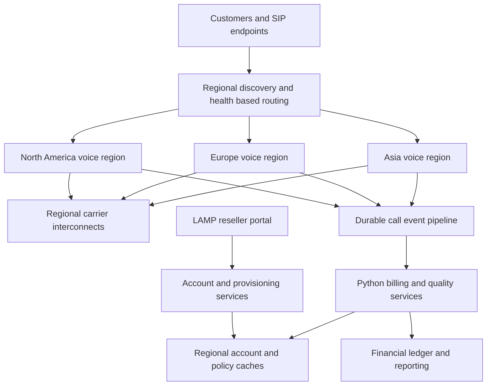

# Global Open Source Voice Platform

A proposed cloud-hosted telecommunications platform for 50 million connected minutes per month and 400,000 customer accounts across North America, Europe and Asia. It combines OpenSIPS for SIP routing, MediaProxy for regional media handling, Asterisk for telephony services, Python for billing and least cost routing, and a LAMP reseller application. Capacity figures are planning estimates. Production capacity and service targets must come from load tests with the intended codecs, call flows and cloud infrastructure.

## Business requirements

The platform must:

- Carry 50 million connected voice minutes per month.
- Support 400,000 customer accounts through a multitenant reseller system.
- Route callers to a nearby healthy media relay.
- Distribute calls across multiple Asterisk servers.
- Select carriers using price and quality, including ASR, PDD and ACD.
- Support prepaid balances, postpaid credit limits, reseller margins and invoicing.
- Keep accepting calls when a server or region becomes unavailable.

Voice processing is separated from account management, so portal activity, billing reports and reseller administration never compete with live calls.

## Capacity model

Peak concurrency, call attempts, codec choice, recording and transcoding set server requirements. Monthly minutes alone do not. Assuming a 30-day month:

| Metric | Planning assumption or calculation |
|---|---|
| Connected minutes | 50 million per month |
| Average simultaneous connected calls | 50,000,000 ÷ 43,200 ≈ 1,157 |
| Peak simultaneous connected calls | 6,000, about 5.2 times the average |
| Average connected call duration | 4 minutes |
| Answered calls per month | About 12.5 million |
| Answer seizure ratio | 40%, illustrative |
| Carrier attempts per month | About 31.25 million |
| Average carrier attempts per second | About 12 |
| Peak attempt load for initial testing | 100 attempts per second, including retries |

The 6,000-call target counts connected calls only. Server and trunk sizing must also cover ringing calls, early media, abandoned attempts and retry bursts.

The 400,000 accounts are provisioned users, not simultaneous callers. If every account re-registered every five minutes, the platform would receive about 1,333 registration refreshes per second before authentication exchanges and reconnect storms. Registration needs its own capacity test.

## Architecture across three continents

Each continent hosts an independently operating voice region spread across at least two availability zones. Account management, billing and reporting sit outside the voice path and reach the regions through caches and a durable event pipeline.

Every voice region contains:

| Component | Responsibility |
|---|---|
| OpenSIPS cluster | Authentication, registration, admission control, SIP routing and Asterisk selection |
| MediaProxy dispatchers and relays | Media allocation, NAT traversal and RTP forwarding |
| Asterisk pool | Call bridging, IVR, announcements, voicemail and required media services |
| Python services | Credit authorization, rating, carrier ranking and quality aggregation |
| Regional caches and event storage | Fast policy access and durable call event delivery |

A MediaProxy dispatcher runs alongside each OpenSIPS instance and talks to it through a local socket. Relays connect to dispatchers over TLS and can serve several dispatchers, so redundant signaling nodes share one regional relay pool. [MediaProxy architecture](https://github.com/AGProjects/mediaproxy/blob/master/README)

## Media routing close to callers

New calls go to the healthy region and relay with the best measured network path, and established calls stay on the media resources they started with. Geography sets the initial preference; measured network performance, available capacity and carrier connectivity refine it.

For each new call, OpenSIPS:

1. Identifies the customer, reseller and preferred region.
2. Checks regional health and available capacity.
3. Selects a healthy local MediaProxy relay.
4. Allocates media ports and rewrites the session description.
5. Keeps later signaling and media operations tied to the selected session.

OpenSIPS can name a preferred relay through its `media_relay_avp` setting. The regional selection policy uses this together with controlled relay membership and health checks. A preferred relay is a preference, so fallback behavior must be tested to confirm it follows regional policy. [OpenSIPS MediaProxy integration](https://docs.opensips.org/manual/3-6/modules/mediaproxy/)

A typical media path is caller ↔ nearby MediaProxy ↔ regional Asterisk ↔ carrier. The exact path depends on whether Asterisk must process media: IVR, recording and transcoding need media anchoring, while calls that can safely bypass Asterisk media processing may use a shorter path after interoperability testing.

Closest means the best practical network path. A geographically nearby relay can still perform poorly because of Internet routing, so selection weighs latency, packet loss and jitter and avoids unnecessary intercontinental media paths.

Moving new calls to another region does not recover media sessions lost with a failed relay.

## Asterisk load balancing

OpenSIPS sends each new call to an Asterisk server with tested spare capacity. Each server advertises a capacity validated for its workload, with separate pools for ordinary bridging, transcoding, recording and conferencing. The OpenSIPS load balancer tracks ongoing calls against configured destination capacity, probes destinations and tries another one when an initial attempt fails. [OpenSIPS load balancing](https://docs.opensips.org/manual/3-6/modules/load_balancer/)

Operational controls:

- SIP health probes plus application and resource checks.
- Capacity limits for sessions, call attempts, CPU and media processing.
- Shared or reconciled admission counters across OpenSIPS nodes.
- Session affinity for established calls.
- Graceful draining before upgrades or removal.

An illustrative starting model is eight Asterisk servers per region, each validated for 500 simultaneous calls under the actual workload. That gives 4,000 calls per region and 12,000 globally. Losing one region leaves 8,000 calls of nominal capacity for a 6,000-call peak, provided the surviving relays, carrier limits, regional traffic distribution and account authorization capacity can carry it.

The 500-call figure is a benchmark target, not a known Asterisk capability; recording and transcoding can change it materially. Established calls on a failed Asterisk server generally disconnect, and healthy servers take the calls that follow.

## Least cost routing with quality controls

One Python service owns carrier ranking and publishes versioned route tables into regional caches, so OpenSIPS never waits on a remote routing call during setup. The service maintains carrier rates, destination prefixes, contractual limits, quality history and reseller routing policies.

Route selection order:

1. Normalize the destination and apply longest prefix matching.
2. Filter by customer permissions, supported codecs, carrier capacity and route availability.
3. Exclude routes that breach quality policy.
4. Rank eligible routes by expected cost and quality.
5. Attempt the selected carrier and apply bounded failover before answer.

Quality is evaluated by destination prefix, carrier, originating region and traffic class.

| Metric | Definition | Routing use |
|---|---|---|
| ASR: Answer Seizure Ratio | Answered carrier attempts ÷ total carrier attempts | Detect deterioration relative to comparable traffic |
| PDD: Post Dial Delay | Time from outbound attempt to a defined meaningful progress event | Identify slow call establishment |
| ACD: Average Call Duration | Answered conversation seconds ÷ answered calls | Detect unexpected changes in completed calls |

PDD must use the same event definition for every carrier. A provisional response without meaningful progress does not count as successful call establishment.

ASR and ACD depend on customer behavior and destination mix. They are diagnostic signals, not direct measures of audio quality; RTP loss, jitter and latency add evidence.

An illustrative policy quarantines a route whose ASR falls well below its destination baseline, whose PDD exceeds its service target, or whose ACD drops sharply with enough samples. Minimum sample counts, rolling windows, recovery probes and hysteresis keep routes from flapping.

Among eligible routes, Python calculates:

`route score = normalized cost + weighted ASR penalty + weighted PDD penalty + weighted ACD penalty`

Lower scores win. Weights and thresholds are configurable by service class.

OpenSIPS has native quality routing for these indicators. Here Python owns the business policy and publishes the decisions, because two ranking systems would compete. [OpenSIPS quality routing](https://docs.opensips.org/manual/3-4/modules/qrouting/)

## Prepaid billing and financial control

Each account balance has exactly one owner, and billing splits into real-time authorization around the call and asynchronous settlement after it.

Before connecting a prepaid call, the authorization service reserves funds and calculates the maximum permitted duration. During the call it extends the reservation, or ends the call when authorized credit runs out. Cross-region calls either get reservations from the balance owner or spend explicitly allocated regional credit budgets; independent regional copies never spend the same balance. If authorization is unavailable, a prepaid call needs a valid existing authorization or a bounded approved allowance.

After the call, Python workers:

- Correlate answer, hangup, transfer and carrier attempt events.
- Apply the tariff version in effect for the call.
- Calculate customer charges, carrier costs and reseller margins.
- Settle reserved funds and release unused credit.
- Write immutable ledger entries and reconciliation records.

Money uses fixed-precision arithmetic. Rates include connection fees, minimum durations, billing increments, currencies and effective dates.

Asterisk can produce several CDRs for one customer interaction, especially with transfers and complex bridging. Billing correlates records and channel events by a platform session identifier instead of charging each CDR separately. [Asterisk CDR specification](https://docs.asterisk.org/Configuration/Reporting/Call-Detail-Records-CDR/CDR-Specification/) Durable events, replayable processing, unique financial transaction keys and reconciliation guard against duplicate charges and missing events.

## LAMP reseller system for 400,000 users

The reseller application runs on Linux, Apache, MySQL and PHP, with stateless application servers behind a web load balancer and database capacity sized from measured transactions and query patterns. It covers:

- Reseller hierarchies and delegated administration.
- Customer accounts, SIP credentials and service packages.
- Retail tariffs, reseller pricing and margin reports.
- Prepaid top-ups, postpaid limits, invoices and payment history.
- Number provisioning, call records and usage exports.
- Branding, permissions and audit history.

Every request enforces tenant boundaries: resellers reach only their authorized accounts and descendants. Financial writes go to authoritative transactional storage. Read replicas serve suitable reports, and background workers handle large exports, invoice generation and provisioning jobs. Large call record tables are partitioned by time and indexed for tenant-scoped access.

The PHP portal calls the Python billing services for every financial action, so rating and balance rules live in one place. A portal outage does not interrupt calls that are already authorized.

## Cloud hosting, bandwidth and cost

Voice workloads run on cloud virtual machines with predictable CPU and networking. Media relays use stable reachable addresses, explicit RTP port ranges, and monitored packet and bandwidth limits. Each region has its own carrier connectivity, local policy caches, durable event buffering and enough spare capacity for its agreed failover share. Autoscaling adds capacity for new calls; scaling in drains active calls first.

For G.711 with 20 ms packetization, allow about 80 kbit/s per one-way RTP stream at the IP layer. A relay carrying both directions receives about 160 kbit/s and sends about 160 kbit/s per call. At 6,000 concurrent calls that is about 960 Mbit/s in and 960 Mbit/s out, before extra media legs, recording and other overhead. Packet rate and port capacity need their own tests.

Across 50 million minutes, one such bidirectional relay path sends about 60 TB. Actual cloud charges depend on Internet egress, availability zone crossings, inter-region paths and provider contracts. The cost model covers compute, media bandwidth, database operations, storage, monitoring, backups and carrier termination; keeping media regional avoids network cost and delay. No provider price is assumed here.

## Validation plan

Before production acceptance, the platform must demonstrate:

- 6,000 connected calls plus the modeled ringing and setup load.
- Sustained peak attempts, retry bursts and registration storms.
- New-call recovery after server, availability zone and regional failures.
- Correct media selection, NAT traversal, early media and carrier interoperability.
- Accurate billing under duplicate, delayed, missing and reordered events.
- No concurrent prepaid overspending across regions.
- Acceptable portal performance during reporting and provisioning peaks.

Until those tests pass, the capacity, availability and savings figures in this study are design objectives, not results. The frontend tests in this repository do not validate any telephony, routing or billing behavior.
