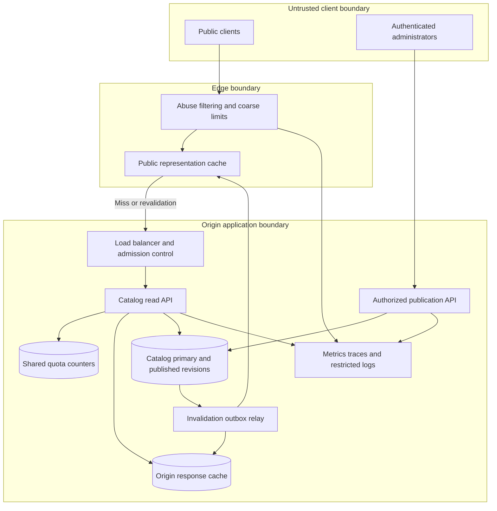

# High-Traffic API Platform

An original, hypothetical public product-catalog API with a separate authenticated administration plane. The architecture is a proposal, not a deployed service. All workloads, cache ratios, limits and service targets below are assumptions that need measurement. No employer or customer material is used.

## Business problem and scope

A retailer's catalog must stay readable during promotions and traffic bursts without letting public traffic exhaust the database or block staff updates. Clients need predictable pagination, clear freshness behavior and useful retry guidance. Operators must distinguish a successful cache response from a fresh response, a rate-limit rejection from an outage, and a popular product from an attack.

The first release serves public descriptions, images and a nonpersonalized indicative price. Checkout price, live stock, personalized offers, accounts and payment APIs are outside the public cache. An authenticated administration plane publishes catalog revisions. No claim is made that a cached price is valid for a transaction; checkout must obtain a current authoritative quote from a separately designed service.

The public catalog is intentionally public. Tenant secrets, draft products and user-specific responses must never enter its shared cache. Customer identity is not required for ordinary public reads; optional API credentials associate a caller with a usage plan, not permission to access private data.

## Requirements and workload assumptions

- Public reads remain available within a declared freshness bound during bounded origin trouble. Beyond that bound, return an unavailable response rather than silently serve indefinitely old content.
- Authenticated administrative responses and mutations bypass shared caches. Publication acknowledgements mean the database change and invalidation intent are durable; they do not mean every edge location is already fresh.
- Per-caller and per-organization limits provide fairness, while separate global concurrency and queue bounds protect the origin. Rate limits are not a complete abuse or denial-of-service defense.
- Assume 50 million public reads/day, around 579 requests/second on average, with an illustrative peak of 10,000 requests/second for ten minutes. Ten minutes at that peak contains six million reads. Distribution by product, region, response size and query shape matters more than the daily mean.
- Assume a 98% edge hit ratio on eligible public requests during warm steady traffic. This is a planning input, not an observed result. Cold starts, invalidations and high-cardinality searches can produce much lower hit ratios.
- Proposed public-read target: 99.95% monthly valid-response availability and p95 under 200 ms from defined client regions. Report per-region results; do not hide a region inside a global average. These are untested targets.
- Proposed publication freshness: eligible public representations have a maximum total cache age of 90 seconds under the policy below. Urgent withdrawal needs a separate tested purge/deny path; the ordinary TTL is not an immediate-removal guarantee.
- Single primary region initially, with a managed multi-zone database and globally distributed edge cache. Proposed regional recovery RPO 15 minutes/RTO four hours requires restore drills and cache/publication reconciliation. A global edge does not make the origin region redundant.

## Architecture and boundaries

Only configured edge infrastructure can reach the public origin listener. The edge strips or overwrites forwarded identity/address headers; the origin trusts only its configured proxy chain. Administrative endpoints use a separate hostname/listener and authorization policy, with independent capacity. This reduces contention but does not remove shared database and control-plane failure domains.

The load balancer distributes requests across stateless API instances. Health checks distinguish a process that can answer a liveness probe from an instance that can safely accept another request. Readiness fails before accepting work that cannot meet the admission/deadline policy. A cache outage must not cause every instance to restart and amplify the incident.

## API and response contracts

`GET /v1/catalog/products/{id}` returns the published public representation with revision, update time and an ETag derived from the representation variant. Variants explicitly include supported locale and currency; the server chooses from a bounded allowlist. It does not vary public output by an undeclared user cookie or authorization header. Unknown products return a safe 404 with a shorter, explicit negative-cache policy; draft visibility is never exposed through this route.

`GET /v1/catalog/products?category=...&cursor=...&limit=...` caps pages at 50 items and permits a bounded set of filters/sorts. An opaque cursor binds query, sort and last key, not caller authority. The initial contract is keyset pagination over published data, not a stable snapshot: concurrent edits may change subsequent pages. If a snapshot is required, introduce an explicit revision-based contract and retention budget. Arbitrary substring queries and unbounded aggregation are outside this API.

Conditional `If-None-Match` requests return 304 only after evaluating the relevant representation and freshness policy. A 304 is not permission to reset a previously stale response without real revalidation. Response metadata identifies the catalog revision; freshness diagnostics expose safe cache status/age without internal hostnames or cache keys. Clients can distinguish a cached catalog view from a transactional quote.

Administrative `PATCH /v1/admin/products/{id}` requires current publish permission, expected product version and a scoped idempotency key for retried mutations. The database transaction updates the product/revision and writes invalidation intent together. Return a durable revision receipt; a lost response is retried with the original key or queried through its operation receipt. Return 409 on version conflict or conflicting key reuse. All administrative requests and error bodies use `Cache-Control: no-store` and bypass edge caching explicitly; a path match alone is not sufficient protection.

Errors have stable codes, a request ID and safe retry guidance. Use 429 for an actual caller quota rejection, 503 for origin/limiter unavailability or admission exhaustion, and 504 only when a gateway deadline has expired. Return `Retry-After` where a meaningful delay can be supplied. Clients use capped exponential backoff with jitter and a retry budget. Do not retry non-idempotent operations under a new key or turn every server error into a tight loop.

## Cache eligibility and freshness policy

Cache only successful, explicitly public GET/HEAD representations from the catalog allowlist. Validate route, query, locale/currency, content type and response cacheability. Do not cache a response that contains user-specific data, `Set-Cookie`, an unexpected authorization-dependent variant or an unapproved redirect. Requests carrying credentials/cookies take a bypass path unless an explicit, tested policy strips them and proves the resulting representation is public. Administrative and private routes are denied cache eligibility independently at edge and origin.

The canonical cache key includes API version, normalized path, validated query, locale/currency and response schema version; cached values record their published catalog revision. Normalization must preserve semantics: different filters cannot collapse to the same key. Reject unknown or duplicate ambiguous query parameters rather than allowing arbitrary key variation. Maintain a small negative-cache TTL, proposed five seconds, for genuinely unknown public products; never share authorization failures or transient server errors as negative product entries.

Proposed mutable-catalog policy: up to 30 seconds fresh, then at most 60 additional seconds stale while a single refresh is attempted or an allowed origin error persists. Age is measured from the last authoritative validation, giving a maximum of 90 seconds; stale hits never extend it. Edge and origin cache layers must carry and account for existing age rather than each starting a new independent 90-second window. Test the selected cache products' age/revalidation behavior before promising this bound.

At the hard age deadline, revalidate successfully or return 503. No unbounded serve-stale fallback is permitted. Revalidation uses current published state from the primary; serving a lagging replica and resetting freshness would undermine the bound. An unchanged representation may renew its validation timestamp after authoritative validation. If read replicas are added, define and enforce an additional replication-lag budget before counting them as fresh.

Static image objects with content-addressed immutable URLs can have a longer cache lifetime; changing bytes creates a new URL. Private attachments never reuse that path. Purging mutable metadata does not revoke previously downloaded public image bytes. The product must explicitly accept public distribution and withdrawal limits.

## Publication, invalidation and withdrawal

A publication transaction commits the new product revision and outbox event. A relay invalidates affected product and category representations at the origin cache and edge, retrying failures with stable event IDs. Invalidation is an optimization for freshness, while the hard age policy is the bounded backstop. Events and cache writes carry revisions; a delayed older refresh cannot overwrite a newer cached revision. Invalidate query families carefully: deleting only a product detail entry leaves category lists stale.

Do not acknowledge a globally completed purge before the provider confirms the intended scope. Track purge lag and failures separately from publication acceptance. A crash after sending a purge but before recording it may repeat the purge safely. Cache refill and publication races require revision comparisons, not only a delete command that an older in-flight fetch can undo.

Urgent withdrawal is a different operation. Mark the item unavailable in the primary, invalidate all known representations and publish a versioned edge denylist. If that denylist cannot be distributed within the required business deadline, bypass or disable affected public serving paths until withdrawal is confirmed. A disconnected edge may otherwise continue serving its allowed stale window. This design claims neither instant global deletion nor protection against copies already downloaded. Resolve acceptable withdrawal behavior before launch.

## Stampede protection and origin admission

Coalesce concurrent refreshes for the same cache key within each serving layer. A short refresh lease reduces duplicate fills; its expiry can still permit competing fetches, so bounded origin admission remains the ultimate protection. A failed refresher releases or expires its lease, and waiters have deadlines. Apply bounded TTL jitter inside the hard freshness envelope rather than extending maximum age.

Warm only a bounded set of known hot representations after deployment. Do not permit arbitrary caller-supplied URLs, headers or query combinations to become prewarm jobs. Bound cache size, key cardinality and eviction churn. A high aggregate hit ratio can conceal one tenant, region or route repeatedly missing.

Set separate limits on in-flight requests, database connections and queued origin work. Admit only work that fits a deadline and resource budget; reject before an unbounded queue forms. Use per-route query timeouts and cancellation propagation so a disconnected client does not leave an expensive query running indefinitely. Avoid layered automatic retries at edge, API and database all multiplying the same request.

## Rate limiting and degraded operation

Use a token-bucket policy with explicit sustained rate and burst capacity per usage-plan organization and credential, plus route-class cost units. An illustrative public plan might allow ten requests/second with a burst of twenty; this is a policy example, not tested capacity or a price. All credentials owned by one organization share its organization budget, preventing extra keys from multiplying entitlement. Record whether HEAD, conditional requests, errors and retries consume budget; the initial proposal charges admitted request attempts, including 304 responses.

A bounded shared counter service coordinates origin quotas with atomic bucket updates and server-controlled time. If hierarchical counters are charged separately, an attempt denied by a later gate may conservatively consume earlier budget; document that behavior rather than assuming an atomic transaction across unrelated stores. TTLs reclaim idle counters; limit key cardinality and never use raw secrets as metric labels or logs. Store a stable internal credential ID and support rotation without resetting the organization's budget.

Anonymous traffic receives coarse edge limits and stricter route budgets. IP limits are abuse signals, not identities: shared networks can penalize innocent clients and distributed traffic can evade them. Sensitive administrative actions have independent authenticated budgets. Edge hits bypass origin counters, so enforcement of a public usage plan across all requests must happen at the edge using verified plan identity or explicitly documented approximate edge quotas. Never advertise an origin-only counter as a strict end-to-end limit.

When shared counters fail, ordinary public origin reads may use conservative per-instance emergency buckets plus a global origin concurrency cap. This preserves some access but cannot guarantee a strict global caller quota: adding instances or hitting multiple locations changes the bound. Expensive administrative/export-like actions fail closed with 503 rather than bypass limits. Log the degraded mode and alert; do not label a counter outage as a caller's 429 violation. A business requirement for hard billing-grade limits would require a different consistency/availability tradeoff.

## Failure scenarios and recovery

- Edge cold start or mass invalidation: coalesce fills, prioritize hot keys and enforce origin admission. Do not assume the steady-state hit ratio during recovery.
- Origin cache unavailable: cap direct database reads and shed excess demand. Cache loss is not permission to exhaust the database pool.
- Primary database unavailable: serve only eligible public representations within their remaining age budget. Administrative writes fail clearly. After the hard deadline, return unavailable rather than invent a fresh validation time.
- Slow downstream: propagate a bounded deadline and cancel work; circuit breakers prevent repeated calls into a known failure. Half-open probes are limited so recovery is not another surge.
- Counter service partition: enter the documented emergency mode for public reads, fail closed for expensive/private actions and expose the enforcement degradation to operators.
- Cache poisoning or private response detected in a public path: disable affected cache eligibility, purge confirmed scope, rotate implicated credentials if needed and inspect restricted request/audit evidence. Re-enable only after variant/key tests and an incident review.
- Region loss: preserve immutable public assets where safe, expire mutable responses at their existing deadlines and restore the authoritative catalog before revalidation. Reconcile publication revisions and replay invalidation intent before reopening writes.
- Retry storm: cap retry attempts/elapsed time, supply retry guidance and shed load early. A recovered database does not help if every client retries simultaneously.

## Observability and service objectives

Measure user-facing requests at the edge as well as origin operations. Report hit/miss/revalidation, age distributions, stale-response fraction, invalidation lag, 429s, admission 503s, timeouts, queue wait, active requests, database pool saturation and limiter degradation. Break down by bounded region, route class and plan tier. Keep product IDs, raw IPs and credential IDs out of unbounded metric labels; restricted sampled logs support investigations.

A valid-response availability objective counts correct, authorized 2xx/304 responses and genuine contract-defined 404s for well-formed public reads; an internal error mislabeled as 404 is not success. Report quota rejections separately with clear denominators; do not improve availability merely by changing rejection classification. Track freshness compliance separately: stale-but-allowed responses can satisfy availability while consuming the declared freshness allowance. Responses beyond the hard age bound violate freshness even if the HTTP status is 200.

Trace representative misses and slow requests using request IDs, bounded sampling and secret scrubbing. Redact cookies, tokens, private query fields and mutation bodies. Aggregate edge/origin telemetry with explicit sampling and coverage; a fast origin dashboard cannot prove global client latency. Synthetic probes check expected product revisions and cache age from defined regions.

Page on sustained error-budget burn, invalidation age approaching its business limit, uncontrolled origin queue growth, or any detected private-cache exposure. Alerts need runbooks and an owner. During incidents, record which freshness and quota modes were active so later metrics do not imply normal guarantees held throughout.

## Capacity and cost sensitivity

At the assumed peak of 10,000 public reads/second and a hypothetical 98% eligible edge hit ratio, approximately 200 requests/second reach the origin. If the hit ratio falls to 80%, that becomes 2,000 requests/second; a cold cache can send all 10,000. These are arithmetic scenarios, not evidence that the origin sustains any of them. Capacity plans must include admission behavior when demand exceeds tested limits.

Assuming a mean 8 KiB response, the ten-minute six-million-request peak transfers about 45.8 GiB of response payload before protocol overhead, compression and retries. Actual bytes vary by representation. Cache hits may reduce origin work while still incurring edge requests and delivery charges. Obtain regional provider rates and measure bytes, misses, purge operations, database work and log volume before estimating spend. No invented dollar quote or cache-savings percentage is claimed.

## Decisions and alternatives

### ADR 014: cache only explicitly public representations

Proposed: a narrow public catalog allowlist and a separate authenticated administration plane. Caching every GET is simpler but risks personalized/private variants leaking through shared keys. Bypassing all caching avoids some leakage risks while increasing origin demand. The chosen approach requires cacheability tests at both edge and origin and explicit ownership of each representation contract.

### ADR 015: bounded stale service with authoritative revalidation

Proposed: a finite fresh-plus-stale envelope with age preserved across layers, primary-backed revalidation and failure after the hard deadline. Always-fresh reads increase origin dependency; indefinite stale service hides outages and violates withdrawal expectations. The exact envelope needs business agreement and provider-behavior tests before commitment.

### ADR 016: quota fairness separate from origin protection

Proposed: plan/caller token buckets plus independent concurrency, deadline and queue bounds. One requests-per-second limit cannot account for different query costs or protect a saturated connection pool. Approximate emergency quotas improve public-read continuity but give up strict global fairness during counter outages; expensive operations fail closed.

### ADR 017: start with bounded query shapes and one primary region

Proposed: limit filters, page size and variants before adding distributed search and multi-region writes. This constrains product flexibility but makes cache keys, query costs and freshness easier to reason about. Revisit with measured query demand and regional latency; a multi-region label alone does not solve conflict resolution or current publication truth.

## Validation plan and unresolved decisions

No load, cache-provider or limiter experiments have been run for this study. Use synthetic public products and isolated credentials to test cold/warm/skewed traffic, invalidation storms, delayed old refreshes, hard-age enforcement across both cache layers, primary failure, regional failure and limiter partition. Test cache-key separation for locale/currency/query variants and prove private/admin responses, cookies, authentication failures and `Set-Cookie` never enter shared entries.

Exercise 304 revalidation, negative-cache expiry after product creation, queue saturation, cancelled clients, deadline propagation, retry amplification and credential rotation across organization budgets. Measure client-region latency percentiles, valid-response availability, freshness violations, quota behavior, database work and rejected demand with documented hardware/provider configuration. A high cache hit ratio alone is not a reliability result.

Resolve acceptable catalog staleness and urgent withdrawal behavior, regional latency needs, anonymous-client fairness, strict versus approximate usage-plan enforcement, expensive query requirements and on-call ownership before promising service levels. The existing document-publication simulation and frontend tests do not validate this API's caching or overload guarantees.
