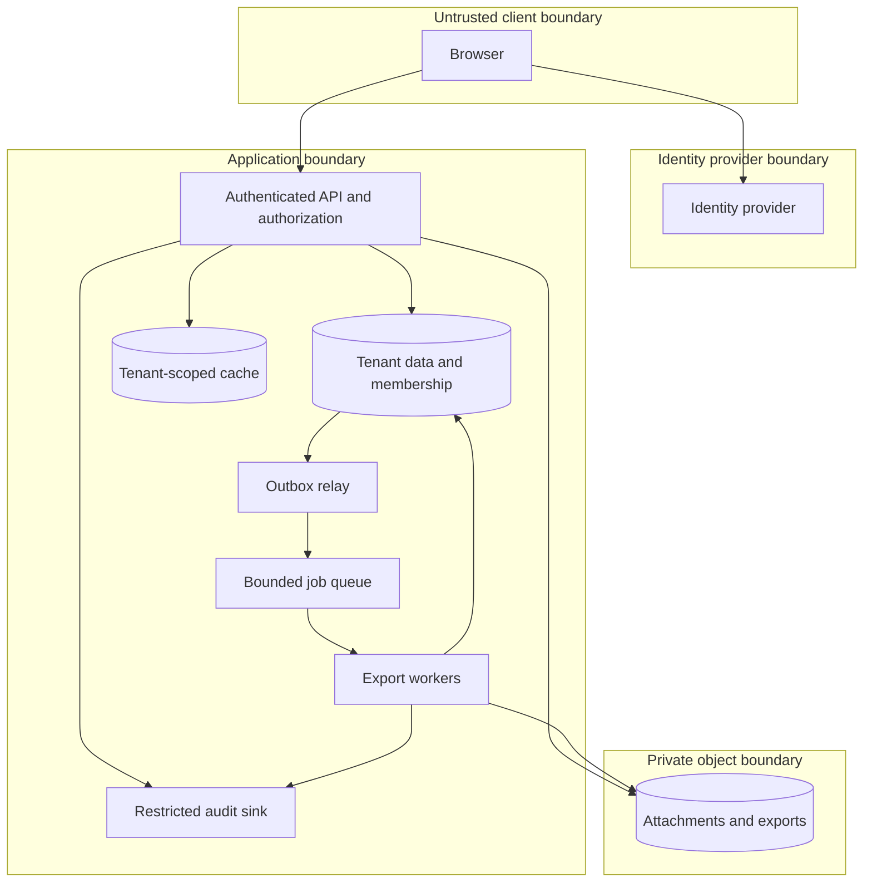

# Multi-Tenant SaaS Platform

An original, hypothetical design for a shared project-workspace product. It is a design study, not an implemented SaaS service or a claim of tested isolation. Workloads and service targets are assumptions. No employer, customer or production account data is used.

## Business problem and scope

Small organizations need shared projects, tasks and attachments while allowing one person to work in several organizations. An organization administrator must be able to invite members, assign limited privileges, remove access and export or delete organization data. A mistake in a URL, cache key or background job must not expose another organization's information.

The first release offers organization-scoped projects, tasks, attachment downloads and asynchronous exports. A user may belong to multiple organizations with different roles. There is no public sharing, cross-organization project, arbitrary user-defined role language or automatic domain-based membership. Billing integrations, regional residency guarantees and customer-managed encryption keys require later designs. A workspace name, email domain or opaque resource ID is never proof of membership.

## Requirements and proposed targets

- Every tenant-owned record, object, cache entry, job and audit event carries a server-validated tenant identity. Database constraints prevent cross-tenant parent-child references.
- Authentication proves who the user is. Authorization separately checks active tenant membership, permitted action and resource scope. Default deny applies to missing context, unknown roles and unknown actions.
- Removing a member blocks subsequent authorization checks; in-flight responses and bytes already downloaded cannot be recalled. A mutation authorized before removal may complete first under the transaction ordering described below. Export downloads use an authorized API proxy rather than long-lived bearer links.
- Ordinary support staff cannot read tenant content. Exceptional support access is time-limited, tenant-approved, narrowly scoped and audited. No universal support bypass is part of the normal application role.
- Proposed availability: 99.9% monthly for interactive API requests. Proposed p95 task-list latency below 400 ms for a bounded page of 50 tasks, under an explicitly tested workload. These are unmeasured targets.
- Assume 500 tenants, 25,000 total members and 2,000 concurrently active users at peak. Assume each active user averages one API request every ten seconds: approximately 200 requests/second. Hot tenants and expensive exports can dominate averages; this arithmetic does not demonstrate capacity.
- Single-region pooled deployment initially. Proposed RPO 15 minutes and RTO four hours depend on tested backup restoration, membership revocation replay and export/deletion reconciliation before reopening access.

## Architecture and boundaries

The API validates the identity provider's signature, issuer, audience and expiry using a maintained authentication integration. A token's tenant or role claim is a hint, not a durable authorization source. Resolve current membership from the primary database for each operation; the initial design does not cache membership decisions. Identity-provider unavailability follows the chosen integration's verification and key-expiry policy, never an improvised allow-all fallback.

A tenant ID in a route selects the requested workspace; it does not establish access. Build one immutable request context only after membership validation. Carry tenant, principal, request ID and allowed action explicitly into data access. Never derive authority from a client-supplied tenant header or accept tenant IDs embedded inside a request body as overrides.

## Authorization model

Four fixed roles keep the first policy reviewable. An organization owner manages administrator assignments, ownership transfer and tenant deletion. An administrator manages projects, member/editor invitations and ordinary memberships. An editor changes projects/tasks and uploads attachments. A viewer reads authorized workspace content. Only owners and administrators may request a full export; download also requires current export permission. Administrators cannot grant owner or administrator privileges, remove an owner or promote themselves. Ownership transfer requires a verified existing member, reauthentication and an atomic change that preserves at least one active owner.

Role checks alone are insufficient. An editor in tenant A must not edit tenant B's project; a valid membership in A cannot authorize a child object whose parent belongs to B. The server loads a resource using both tenant ID and resource ID, checks the action against the effective role, and verifies parent scope. List, search, bulk operations and counts follow the same rule. A missing or inaccessible object returns a scoped 404 without disclosing whether it exists elsewhere. Authentication failure returns 401; denied tenant-level actions return a safe 403 without listing inaccessible tenants.

Membership removal and role changes increment a membership version. Sensitive mutations load and lock the acting membership row in the same transaction as the resource change. Removal or demotion contends on that row, establishing a clear before/after order. This protects the authorization check from a check-then-write race; it does not undo an operation that won the lock first. Resource updates separately compare the expected resource version. Owner changes also lock the tenant ownership record to prevent two concurrent removals from deleting the last owner.

Reads check current membership in a short primary-database transaction before returning data, including cache hits. A read authorized before removal may finish afterward; later checks deny it. Exports and attachment streams reauthorize at initiation, enforce bounded response lifetimes and terminate when the application observes revocation. They cannot retract delivered bytes, and no instantaneous mid-stream revocation guarantee is claimed. Define the acceptable response lifetime with prospective customers.

## Data isolation and connection handling

The proposed pooled relational schema uses composite keys and foreign keys:

- `tenants`: tenant ID, lifecycle, ownership version and deletion generation.
- `memberships`: unique `(tenant_id, principal_id)`, role, active state and membership version; principal IDs come from the validated identity mapping.
- `projects`: primary key `(tenant_id, project_id)`, name and resource version.
- `tasks`: primary key `(tenant_id, task_id)`, composite foreign key `(tenant_id, project_id)` to projects. Cross-tenant references fail even if application filtering is missed.
- `attachments`: tenant/resource relationship, immutable object version, size, digest and lifecycle. The application chooses the object prefix; user filenames are metadata only.
- `jobs`: tenant, requester principal, required action, job ID, generation, state, lease and deletion generation. Unique operation IDs scope deduplication to the tenant.
- `invitations`, request keys, inbox/outbox and audit metadata also carry tenant scope and explicit expiry/retention rules.

Row-level security is defense in depth alongside scoped queries and application authorization. The application database role must not own protected tables, act as a superuser or have a row-security bypass privilege. Force policies where appropriate, review every policy and function, and use a separate restricted migration role. Table ownership or a privileged helper can defeat an otherwise correct-looking policy.

The data-access layer starts a transaction, installs validated tenant/principal context transaction-locally, performs authorized queries, then commits or rolls back. Missing context denies access. Never use session-level tenant settings that can survive a pooled connection checkout. Context must be set again on every transaction, including retries, read paths and worker queries. A tenant-setting mechanism controlled by the application does not protect against a fully compromised application process or SQL injection; parameterized queries, least privilege and isolation tests remain necessary.

Connection reuse tests must alternate tenants on the same physical connection after success, error, cancellation and rollback. Background workers use the same scoped data-access path. Migration, analytics and backup roles have separate capabilities and are not available to request handlers.

## API, invitations and tenant switching

`GET /v1/tenants/{tenant}/projects/{project}/tasks?cursor=...` returns at most 50 tasks after authorization. Cursors bind tenant, query and sort order; they are opaque and cannot override tenant filters. Limit pagination and search work to avoid an unbounded tenant query. `PATCH /v1/tenants/{tenant}/tasks/{task}` includes an expected resource version and returns 409 on conflict. Bulk updates either validate every target and commit atomically within one tenant or reject the batch; there is no partial cross-tenant batch.

Invitations use a random, single-use, expiring token stored as a hash, bound to tenant, intended verified identity/email and a role the inviter can grant. Redemption requires authenticated identity matching and rechecks the inviter's present grant authority. Revoking an invitation or removing its inviter invalidates outstanding authority. Acceptance and token consumption commit together; repeated redemption cannot create a second membership. Do not autojoin users because their email suffix resembles the organization name.

A tenant switch is a new authorized request context. The browser discards old workspace data, cancels outstanding requests and keys client-side queries by tenant and principal. Responses also identify their tenant so a delayed response for A cannot populate B's view. Server authorization remains mandatory even if the browser switch logic fails. CSRF defenses are required for cookie-based sessions; choose and test the concrete authentication/session integration before implementation.

## Caches, objects and background work

Cache keys include tenant, resource type, resource ID and content version. User-specific projections also include principal or permission version. Authorization occurs before reading a cached value. Membership lists, export capabilities and authorization decisions are initially uncached; mutable privileged data is not served from an unscoped CDN or shared browser cache. A tenant identifier inside a cache key helps partition data but is not an access check. Cache failures fall back to authorized database reads within admission limits.

Object paths use server-generated tenant prefixes and immutable versions. A shared bucket's prefix is an organizational convention, not an authorization boundary by itself. Storage identities permit only required operations; scoped credentials or a narrow storage broker limit each worker to its assigned tenant/job. Attachment and export downloads pass through the authorized API proxy, which verifies metadata ownership before fetching the object. Guessing a key or retaining an expired job URL cannot authorize a download.

Export creation commits a tenant-scoped job and outbox intent together. Queue messages contain identifiers, not a reusable user token or authority grant. At execution, the worker reloads the tenant lifecycle and requester's current membership, rechecks export permission and validates the expected deletion generation. It repeats authorization before publication; a requester removed during execution cannot receive a published export. A private temporary artifact may exist until cleanup, but downloads always reauthorize independently.

Workers read in bounded chunks rather than one long transaction. Record a source watermark and export semantics: the initial proposal is a best-effort view over the export interval, not a single consistent database snapshot. If customers require a point-in-time export, design snapshot lifetime, replica load and retention separately. Deduplicate jobs by tenant and operation ID; a worker restart must not publish another tenant's artifact or revive a deletion generation.

## Noisy neighbors and scaling

Apply tenant-aware request, byte, export and concurrent-job quotas in addition to global protection. Schedule jobs fairly and bound per-tenant query time and export memory. Return a stable quota error with retry guidance; do not silently drop a job already acknowledged as durable. One tenant's admission limit cannot prevent a global database failure, so maintain global backpressure and incident controls too.

Shared tables keep migrations and operations simpler but enlarge the failure domain. Index access paths with tenant scope, inspect query plans on skewed synthetic data and monitor tenant-specific slow requests through restricted logs. Avoid unbounded tenant IDs as metric labels. A large tenant may need dedicated worker capacity before it needs a dedicated database.

If contractual isolation or measured contention requires a database-per-tenant tier, use a server-controlled routing registry, one authoritative write location, an audited migration state machine and a cutover fence. Never let a request header select a database connection. Cache/object routing must change consistently; a split database alone does not isolate shared queues, logs or storage. Cross-region residency and stronger administrative isolation are new commitments, not implied by this pooled design.

## Failure handling and incident response

- Missing tenant context: deny before a query; emit a safe internal signal. Never substitute a default tenant.
- Stale membership or replica lag: authorization uses primary state. If primary membership cannot be read, deny the operation and report temporary unavailability rather than granting from a token role.
- Connection context leak: stop affected traffic and workers, revoke implicated credentials, preserve restricted audit evidence and determine exposure scope. Disabling only the cache cannot fix a database isolation bug.
- Cache key collision or missing tenant dimension: invalidate affected entries, disable the faulty cache path and audit accesses. Rebuild only after isolation tests pass; a miss is safer than serving an ambiguous entry.
- Worker runs after revocation/deletion: execution/publication checks reject it; clean up unpublished objects. Lost queue acknowledgements redeliver the same job ID and do not bypass lifecycle checks.
- Role-policy change: version the policy, review permission expansion and roll out with negative authorization tests. A deployment rollback must not silently restore a removed membership or owner.
- Database restore: replay a separately protected revocation/deletion journal before reopening access. If that journal's recovery point cannot establish current restrictions, keep affected tenants disabled and reconcile with administrators. Backups alone can restore old permissions.
- Suspected tenant data exposure: suspend affected paths, identify accessed resources from restricted audit records, follow the organization's incident notification process and document corrective action. No untested compliance or zero-exposure guarantee is made.

## Export, deletion and audit lifecycle

A tenant owner requests deletion with reauthentication and expected tenant version. The first transaction tombstones the tenant and advances its deletion generation, blocking API access, queued work and publication. A reconciler removes tenant rows, cache entries, attachment/export versions and temporary artifacts in bounded, retryable steps. Confirm each subsystem and expose progress to the authorized deletion operator. Unique job IDs and lifecycle guards prevent stale retries from recreating data.

Assume exports expire after 24 hours and active tenant deletion aims to remove live content within seven days. These are proposed product policies, not implemented guarantees. Backups may retain copies until an illustrative 35-day expiry; disclose the distinction and ensure restores reapply deletion restrictions before serving data. Determine accounting, audit and legal exceptions with the business rather than inventing a universal retention period.

Audit permission changes, invitations, exports, support grants, deletion, routing changes and privileged failures. Record actor, tenant, action, resource, outcome, request ID and policy version in a restricted append-only sink, with tested delivery/reconciliation. Keep raw attachments, credentials and invitation tokens out of logs. Decide audit retention and access separately from ordinary content retention. A shared audit sink is another cross-tenant exposure surface that requires access controls and review.

## Cost and capacity reasoning

With the assumed 200 peak requests/second, one primary membership lookup per request adds approximately 200 authorization lookups/second before resource queries, writes and retries. This is request-count arithmetic, not a database throughput result. Measure contention from membership locks, skewed tenants and concurrent exports before selecting capacity. Do not cache authorization merely because an untested sizing calculation looks expensive.

Compare pooled and dedicated models using database floor costs, connection budgets, migration effort, backup/restore work, cache memory, object storage and export egress. Dedicated tenant databases may increase baseline cost and operations while reducing certain shared-data risks; they do not automatically solve authorization. No vendor prices or savings percentages are asserted. Rate limits and quotas protect fairness, not a promise of hard billing isolation.

## Decisions and alternatives

### ADR 010: pooled rows with layered isolation

Proposed: tenant-scoped keys/queries, composite constraints, restricted row-security policies and explicit request context. Database-per-tenant offers stronger data-plane separation but adds provisioning, routing, migrations and restore work. Pooled deployment accepts a wider administrative and runtime blast radius. Revisit for contractual boundaries, residency or measured contention.

### ADR 011: primary membership checks before cached content

Proposed: resolve current authorization per operation instead of treating long-lived token roles or cached membership as truth. Cost: primary-database dependency and lookup load. Benefit: bounded policy semantics without a separate authorization-cache invalidation protocol. If measured scale requires caching, first define a revocation window and a versioned invalidation design; do not quietly weaken the contract.

### ADR 012: fixed roles with owner-only privilege escalation

Proposed: a small role/action matrix with object-scope checks and protected ownership transfer. A custom policy language could express finer rules but increases review complexity and privilege-escalation paths. Revisit after concrete customer needs and policy testing. Product UI visibility never replaces server enforcement.

### ADR 013: authorized proxy for private exports

Proposed: proxy downloads after current authorization instead of issuing long-lived object-store links. Cost: application bandwidth and connection load. Benefit: a copied URL does not independently grant access. Already delivered bytes and an in-flight authorized response remain outside revocation; if short-lived bearer grants are introduced later, explicitly change that contract and disclose the window.

## Validation plan and open questions

This repository has not run database, identity-provider, object-store or isolation experiments for this study. Before implementation, create two synthetic tenants with overlapping resource IDs and a principal holding different roles in each. Exercise every list/detail/search/bulk/export path with missing, forged and swapped tenant context. Test cross-tenant foreign keys, row-policy owner/bypass behavior, pooled connection reuse after rollback, cache hits before/after removal and worker publication during deletion.

Race removal against mutation, simultaneous owner removals, invitation redemption after inviter demotion, delayed tenant-switch responses and duplicate export delivery. Restore an old backup and prove revocations/tombstones are reapplied before access. Run skewed-tenant load tests and measure export interference and denial behavior under primary failure. Record test artifacts and observed limits; frontend accessibility checks cannot validate backend tenant isolation.

Open decisions: acceptable response/download lifetime during revocation, invitation identity matching rules, support-access approval process, audit/backup retention, consistent-export requirements, per-tenant quotas and the threshold for dedicated routing. Resolve these with prospective tenants and an operations review before offering security or availability commitments.
