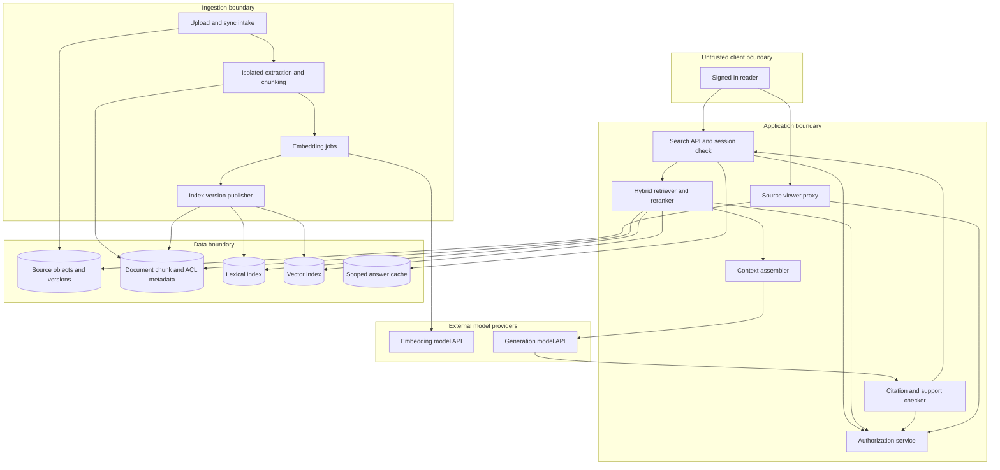

# RAG Document Search

An original, hypothetical retrieval-augmented search service for a permission-controlled document collection. The architecture is a proposal, not a deployed service. Corpus sizes, latency budgets, quality targets and model behavior below are assumptions that need measurement. No evaluation has been run, no scores are reported and no employer or customer material is used.

## Business problem and scope

An organization keeps policies, procedures, project notes and reference manuals across teams. Staff waste time finding the current version of a rule, and keyword search misses paraphrased questions. The product goal is a search page that answers a question in a few sentences and shows exactly which passages from which document versions support each statement, so a reader can open the source and check it.

The collection is permission-controlled. Two people asking the same question may be entitled to different evidence, and therefore different answers. A useful answer that discloses one restricted sentence is a security failure, not a quality tradeoff. The service must also say clearly when the permitted evidence does not answer the question.

In scope: ingestion of uploaded or synchronized documents, extraction, chunking, embeddings, versioned index publication, hybrid retrieval, authorization filtering, bounded answer generation with citations, source viewing and evaluation. Out of scope for the first release: autonomous actions or tool calls driven by answers, cross-tenant search, conversational memory across sessions, web search, legal or medical advice workflows, fine-tuning on customer documents and any claim that an answer is authoritative without the cited source.

## Requirements and assumptions

- Evidence a caller is not currently authorized to read never reaches the generation model, the answer, the citation list, snippets, ranking diagnostics or the answer cache. Authorization is checked at retrieval and rechecked before the response and before a citation opens.
- Every citation identifies a document, an immutable source version and a passage span that was actually retrieved for this request. The citation must point to text that supports the claim; a resolvable link alone is not enough.
- When permitted evidence is insufficient, obsolete or conflicting, the service says so rather than filling the gap from model knowledge.
- Deleted documents and revoked access stop appearing in results within a proposed freshness bound, and a delete tombstone blocks serving before background cleanup completes.
- Assume one tenant in the first release with 200,000 documents, a median of 12 pages, around 30 chunks per document and therefore about six million chunks. Assume 2,000 searches per business hour with an illustrative peak of 5 searches/second. These are planning inputs, not measured load.
- Proposed targets, all untested: p95 retrieval under 800 ms, p95 time to first answer token under 3 seconds and complete answer under 10 seconds for a bounded context; newly granted access retrievable within 5 minutes; delete tombstone applied within 60 seconds of an accepted deletion. Quality targets are not set until a held-out evaluation exists.
- Assume an external embedding provider and an external generation provider reached over authenticated APIs with contractual no-training and limited-retention terms. Whether customer text may leave the boundary at all is an unresolved decision; a self-hosted model alternative changes cost and operations, not the authorization design.

## Architecture and trust boundaries

The client is untrusted and supplies only a question and optional filters. Caller identity comes from the server-validated session; any tenant, group or document filter in the request can narrow results but can never widen them. The authorization service owns current group membership and document ACLs; indexes carry denormalized ACL labels only to make filtering efficient, and they are never the final authority.

Extraction runs in an isolated worker without network access to internal services or providers, because documents can be malformed or hostile. The generation model sits outside the trust boundary in both directions: it receives only authorized evidence, and its output is treated as untrusted text until citations are validated. The model has no tools, no network access through the service and no ability to fetch documents by identifier.

## Ingestion and versioned index publication

Intake accepts a document, records a source version with content hash, uploader, ACL snapshot reference and declared type, and stores the original bytes immutably. Validation rejects unsupported types, oversized files, encrypted archives and files whose detected type disagrees with the declared one. A rejected file produces a visible ingestion status, not a silent gap in search.

Extraction produces normalized text with structural markers: page numbers, headings, table boundaries and section paths. Extraction failures and low-confidence results such as scanned pages without text are recorded per page. OCR is a separate, optional step with its own version so a later OCR change can be traced. Chunking splits on structure first, then on a token budget, with a proposed 400 to 800 token window and small overlap; each chunk records its character offsets within the extracted text and its page or section range so it can be mapped back to the original.

Embedding jobs batch chunks, call the embedding provider with bounded concurrency and record the embedding model identifier and dimension for every vector. A partially embedded document is not searchable. Publication is versioned: a document version becomes visible only when its extraction, all chunks, all embeddings and lexical entries are written under one index generation and the publisher flips the document's active version pointer in metadata. Readers resolve the active pointer at query time, so a half-built version is never served and the previous version keeps serving until the flip.

Re-embedding the corpus for a new embedding model builds a parallel index generation. Queries use a single generation end to end because vectors from different models are not comparable. The cutover happens after the new generation passes the evaluation gate described below, and the old generation is retained for a bounded rollback window.

## Identifiers, provenance and data invariants

- `document_id` is stable for a logical document. `source_version_id` identifies immutable bytes by content hash. `extraction_version` records the extractor and settings. `chunk_id` is derived from source version, extraction version and chunk ordinal, so re-chunking yields new identifiers rather than silently changing old ones.
- Each chunk stores tenant, document, source version, extraction version, character start and end, page or section range, ACL label set, ingestion time and index generation. Each vector stores chunk ID, embedding model ID and generation.
- An answer record stores request ID, caller principal, index generation, retrieved chunk IDs with ranks and scores, the subset included in model context, prompt template version, generation model ID and the final citations. Raw question and answer text follow the retention policy below.
- Invariants: no chunk exists without a source version; no vector exists without a chunk in the same generation; no active version pointer references an incomplete generation; a citation references a chunk that appears in that request's retrieved and authorized set; a tombstoned document has no active version pointer.
- A periodic reconciliation job compares metadata, lexical and vector indexes and reports orphans or missing entries per generation. Reconciliation repairs by republishing from source, never by inventing metadata from index contents.

## Retrieval and context assembly

Lexical retrieval with BM25-style scoring is strong for exact identifiers, policy numbers, product codes and rare terms. Vector retrieval handles paraphrase and vocabulary mismatch but can return topically similar passages that do not answer the question, and it is weak on exact identifiers. The proposed default is hybrid retrieval: run both with the same authorization filter, take a bounded candidate list from each and merge using reciprocal rank fusion, which avoids comparing raw scores across systems.

An optional cross-encoder reranker reorders the merged candidates. It adds latency and another model dependency, so it is enabled only if the held-out evaluation shows a meaningful ranking improvement for its cost. If the reranker times out, the service falls back to fused ranking and records that it did.

Context assembly selects the top passages within a fixed token budget, proposed at about 6,000 tokens of evidence, and removes near-duplicate passages across versions of the same document. It prefers the active version of each document; superseded versions are excluded unless the question asks about history and the caller is authorized. Each passage is wrapped with its citation key, document title, version date and status so the model can refer to it and the verifier can check it. Question rewriting or expansion, if used, never changes the caller's authorization scope.

## Authorization before generation

Authorization is enforced as a filter inside retrieval, not as a post-filter on the final answer. Both lexical and vector queries include the tenant and the caller's resolved ACL labels, so restricted chunks are never candidates. Post-filtering after top-k retrieval is rejected because it leaks through ranking and can starve results: if the top 50 are all restricted, an honest caller gets nothing while the system has already processed restricted text.

Denormalized labels in the index can lag the authoritative ACL. Before context assembly the retriever rechecks each candidate chunk's document against the authorization service using current membership. Before the response returns, the verifier confirms that every cited document is still readable. When a reader opens a citation, the source viewer proxy checks access again and serves only the cited version's span and surrounding page; it never issues long-lived direct object links.

A document the caller cannot read is indistinguishable from a document that does not exist. Answers, insufficient-evidence messages, result counts and timing diagnostics do not reveal that restricted evidence exists. Administrators do not receive a universal search bypass; privileged review uses a separate, audited workflow.

## ACL changes, deletion and freshness

ACL and group-membership changes are recorded as events. The authorization service reflects them immediately for rechecks, and an index updater rewrites affected chunk labels in the background. The recheck makes revocation effective at query time even while index labels are stale; the 5 minute target applies to label convergence and therefore to how quickly newly granted access becomes retrievable, not to how quickly revoked access stops being served.

Deletion writes a tombstone first. The tombstone removes the active version pointer, which immediately excludes the document from retrieval, viewer access and cache validity. Background cleanup then deletes chunks, lexical entries, vectors in every retained generation, extracted text, OCR output, temporary extraction artifacts and cached answers whose citation set includes the document. Cleanup is idempotent and resumable, and reconciliation verifies that no artifact for a tombstoned document remains after the retention window. Provider-side copies are governed by provider retention terms, which this design cannot verify directly.

Answer caching is scoped by tenant, normalized question, index generation and a hash of the caller's effective ACL label set, and each entry records its cited document versions. An entry is invalid if any cited document is tombstoned, superseded or no longer readable by the caller. A cache hit still passes the response-time authorization recheck. If that guarantee cannot be met cheaply, the answer cache is disabled; retrieval results may be cached under the same scoping instead.

Stale indexes are detected by comparing the active version pointer and ACL version for each returned chunk with authoritative metadata. A mismatch excludes the chunk and increments a freshness metric rather than serving outdated evidence.

## Citation integrity and answer contract

The response contains answer statements, each with zero or more citation keys, plus a citation list with document title, version date, page or section and the exact cited span. The model is instructed to cite only provided keys. The verifier rejects any key not present in the assembled context, any key whose chunk failed the recheck and any citation whose span offsets fall outside the chunk.

Validating that a key exists does not establish that the passage supports the claim. A second check compares each statement with its cited passages using a lightweight entailment or overlap classifier and flags weakly supported statements. Flagged statements are either removed, rewritten as uncertain or returned with a visible low-support marker, depending on the decision below. This check reduces obvious errors; it does not prove correctness, and its own error rate must be measured against human judgments.

Defined outcomes:

- Answered: statements are supported by cited, current, authorized passages.
- Insufficient evidence: no permitted passage answers the question. Return the closest relevant sources, if any, without asserting an answer, and never mention restricted material.
- Conflicting sources: present each position with its citation and version date and state that the sources disagree. The service does not choose a winner unless an explicit precedence rule exists, such as a newer approved policy superseding an older one.
- Obsolete evidence only: say that the only matching sources are superseded or past a review date and show their dates.
- Unanswerable or out of scope: requests for opinions, predictions or information outside the corpus receive a clear refusal to answer from the documents.

## Untrusted content and prompt injection

Retrieved text is data, not instructions. A document can contain text such as an instruction to ignore previous rules, reveal a system prompt or cite a different source. The prompt template separates instructions from evidence with explicit delimiters and tells the model that evidence never changes its task. Delimiting reduces risk but is not a reliable defense on its own, so the design limits what a successful injection can achieve.

- The model has no tools, cannot request documents and cannot widen retrieval. Everything it sees was already authorized for this caller, so an injection cannot pull in restricted evidence.
- The model output is rendered as plain text with citation markers. Markdown links, images and HTML from model output are stripped to prevent data exfiltration through URLs.
- Citations are validated against the assembled context, so an injected instruction cannot fabricate a citation to a document the caller did not retrieve.
- Ingestion scans for secrets such as keys and tokens and for patterns typical of injection attempts. Matches are quarantined for review or excluded from indexing; scanning is heuristic and will miss some cases.
- Poisoned documents, meaning authorized but false or manipulative content, are a governance problem. Source status, owner and review date are shown with every citation, and readers can report a passage. Retrieval does not boost recently uploaded documents by default.

## Failure scenarios and safe fallback

- Embedding provider timeout or quota exhaustion during ingestion: retry with capped exponential backoff and jitter, then park the document in a visible pending state. Never publish a partially embedded version.
- Embedding provider failure at query time: fall back to lexical-only retrieval, mark the response as degraded and record it. Do not embed the query with a different model against the existing index.
- Generation provider timeout, quota or outage: return ranked authorized sources with snippets and no generated answer, labeled as search results. A partial streamed answer that is interrupted is discarded or clearly marked incomplete, and its citations are not shown as verified.
- Generation model change by the provider: pin model versions where the provider allows it. Treat any model or prompt template change as a release that must pass the held-out evaluation gate.
- Partial ingestion or crash mid-publication: the active version pointer is not flipped, so the previous version keeps serving. A resumable job completes or abandons the generation; reconciliation removes orphans.
- Stale publication: if index labels or versions disagree with authoritative metadata, exclude the affected chunks and alert when the exclusion rate exceeds a threshold.
- Authorization service unavailable: fail closed for search and source viewing. Cached answers are not served without a recheck.
- Retries are bounded by attempt count and total request deadline. The service does not retry generation with a larger context or a different model automatically.

## Observability, privacy and cost

Metrics: retrieval latency per stage, candidate counts after authorization filtering, recheck exclusions, verifier rejections, low-support flags, outcome mix by type, degraded-mode rate, provider latency and errors, token counts, ingestion backlog, tombstone cleanup lag and ACL label convergence lag. Labels stay bounded: no document IDs, user IDs or query text in metric labels.

Questions and answers can contain sensitive information. Default logs record request ID, principal hash, index generation, chunk IDs, outcome type and timings, not raw question or answer text. Raw text retention for quality review is opt-in, short, access-controlled and excluded for documents marked highly restricted. Prompts sent to providers contain only authorized evidence and the question.

Latency budget, all proposed: authorization resolution 50 ms, parallel lexical and vector retrieval 300 ms, reranking 250 ms, recheck and assembly 100 ms, leaving the remainder for generation and verification. Each stage has a timeout and a defined fallback.

Cost drivers are corpus size times embedding passes, re-embedding on model change, vector index memory and replicas, reranker inference, generation input tokens dominated by context size, output tokens, cache hit rate and evaluation runs. At the assumed six million chunks and an illustrative 500 tokens per chunk, one full embedding pass processes about three billion tokens. Obtain current provider rates and measure real token counts before estimating spend; no vendor price is assumed here.

## Evaluation plan

No evaluation has been run. This plan defines what would count as evidence before any quality claim is made.

Corpus: a synthetic corpus written for the evaluation, or a permission-cleared sample with documented consent and no secrets. It must include multiple versions of the same document, superseded policies, near-duplicates, tables, scanned pages, documents with injected instructions and documents under at least three distinct ACL groups. The corpus, ACL assignments, extraction settings, chunking parameters, embedding model, index generation, prompt template and generation model are recorded together as one versioned configuration.

Question set: answerable with a single source, answerable only by combining sources, unanswerable from the corpus, ambiguous, conflicting between sources, answerable only from an obsolete version, and access-denied where the only supporting evidence is restricted for the test principal. Each question records its type, the test principal, expected outcome and, where applicable, the supporting passages.

Judgments: at least two human reviewers label relevant passages and supporting spans per question using written guidelines, with disagreements adjudicated and inter-rater agreement reported. Questions are split into a development set for tuning chunk size, retrieval depth, fusion and prompts, and a held-out set used only for release decisions. The held-out set is not inspected during tuning.

Measures, each reported with its denominator:

- Retrieval: recall at k of labeled supporting passages and a ranking measure such as nDCG at k, over answerable questions only.
- Citation correctness: the share of citations whose passage supports the attached statement, judged by humans. Citation coverage: the share of answer statements with at least one supporting citation.
- Answer support: the share of answers in which every statement is supported by cited evidence.
- Abstention: correct abstention rate on unanswerable, obsolete-only and access-denied questions, and false abstention rate on answerable questions.
- Authorization: count of any restricted chunk appearing in candidates after filtering, model context, answer, citations, snippets or cache. The target is zero, and a single occurrence blocks release regardless of other results.
- Conflict handling: the share of conflicting-source questions where both positions are presented with citations.

Report results sliced by document type, question type and failure class, with sample sizes per slice. Small slices are reported as counts, not percentages. Include confidence intervals, for example Wilson intervals for proportions or bootstrap intervals for ranking measures, and avoid claiming improvements whose intervals overlap substantially. An automated model judge may help triage at scale, but it is calibrated against human labels on a sample, its agreement is reported, and it is never presented as proof that answers are correct. Evaluator limitations, corpus representativeness and the gap between synthetic questions and real user questions are stated alongside results.

## Decisions and alternatives

### ADR 018: authorization filtering inside retrieval with rechecks

Proposed: apply tenant and ACL filters within both lexical and vector queries, then recheck current access before context assembly, before responding and when a citation opens. Post-filtering after retrieval is simpler with some vector stores but leaks through ranking and can return nothing for honest callers. Separate per-group indexes give strong isolation but multiply storage and complicate documents shared across groups. The chosen approach depends on index engines that support efficient filtered search at the expected label cardinality, which must be tested.

### ADR 019: versioned index generations with an active pointer

Proposed: publish document versions atomically through an active version pointer and run embedding-model changes as parallel generations. In-place updates use less storage but can serve mixed or partial state. Full rebuilds for every change are simple but slow and expensive. Generations require reconciliation and retention policies for old vectors, including deletion across all retained generations.

### ADR 020: hybrid retrieval with optional reranking

Proposed: lexical plus vector retrieval merged with reciprocal rank fusion; reranking enabled only when held-out evaluation shows sufficient benefit for its latency and cost. Vector-only retrieval is simpler but weak on exact identifiers. Lexical-only retrieval is cheaper and more predictable but misses paraphrase. The fusion depth and reranker choice are tuning decisions made on the development set.

### ADR 021: abstain and show sources rather than answer without support

Proposed: structured outcomes for insufficient, conflicting, obsolete and out-of-scope cases, with citation validation and a support check before display. Always answering feels more helpful but invites unsupported claims. Showing only search results avoids generation risk but gives up the summary readers want. The chosen approach trades some answer rate for inspectability and needs measured false-abstention rates to stay usable.

## Validation plan and unresolved decisions

No ingestion, retrieval, model or load experiments have been run for this study. Validation needs synthetic or permission-cleared documents and isolated test principals. Test filtered retrieval at realistic label cardinality, revocation during an in-flight request, deletion during embedding, tombstone cleanup across retained generations, cache invalidation on ACL change, provider timeout and quota paths, mid-publication crashes, model version changes, injected instructions in documents and model output containing links or markup. Measure stage latencies and token counts under a documented workload.

Decisions for review:

- Authorization: whether rechecks at three points fit the latency budget, how ACL labels are represented for large group counts, and whether highly restricted documents should be excluded from generation entirely and offered only as search results.
- Index freshness: acceptable label convergence time for newly granted access, the tombstone deadline, the retention window for old generations and whether the answer cache is worth its invalidation complexity.
- Evaluation: minimum held-out set size per slice for a release decision, the release gate thresholds, how often the held-out set is refreshed, and how low-support statements are presented.
- Provider boundary: whether document text may be sent to external providers, required retention terms, and whether a self-hosted model is required for some document classes.

The document-publication simulation and frontend tests in this repository do not validate any retrieval, authorization, citation or model guarantee described here.
